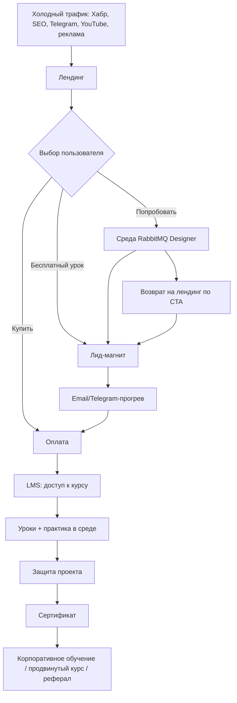

# План запуска продающего лендинга: курс + среда RabbitMQ Designer

**Версия:** 1.0 (рабочий черновик)  
**Дата:** 22.10.2026  
**Связанные материалы:** `MQ-Designer.github.io/README.md`, `MQ-Designer.github.io/ROADMAP.md`  
**Продукт:** [RabbitMQ Designer](https://gustafor.github.io/MQ-Designer.github.io/)  
**Статус:** план на согласование. Цифры, цены и названия — гипотезы, которые нужно подтвердить до разработки.

## Как пользоваться планом

| Если нужно | Смотрите разделы |
|---|---|
| Понять идею и границы проекта | 0, 4, 6 |
| Утвердить оффер, аудиторию и цены | 3, 4, 5 |
| Собрать структуру и тексты лендинга | 7, 8 |
| Передать дизайнеру и разработчику | 9, 10 |
| Настроить аналитику и SEO | 11, 12 |
| Проверить юридические риски | 13 |
| Спланировать сроки и бюджет | 14, 15 |
| Запустить и проверить | 16, 17, 18 |

---

## 0. Резюме для руководителя

### 0.1. Что делаем

Создаём отдельный продающий сайт, который решает две задачи одновременно:

1. **Продаёт обучение** проектированию RabbitMQ-топологий для Java/Spring-разработчиков, архитекторов и команд.
2. **Показывает среду проектирования** RabbitMQ Designer как главный практический инструмент курса и самостоятельный продукт.

Сейчас по ссылке открывается **само приложение**, а не лендинг. У него нет оффера, формы заявки, оплаты, аналитики, SEO-структуры и юридических страниц. Холодный трафик на такую страницу почти не конвертируется: человек видит инструмент, но не понимает, зачем ему курс и что он получит через 6 недель.

### 0.2. Главная идея позиционирования

> **Не «курс по RabbitMQ» и не «ещё один визуализатор», а связка «учусь → проектирую → проверяю → получаю артефакты».**

Продаём результат: студент собирает топологию, прогоняет её в симуляции, видит маршрут каждого сообщения и на выходе получает `definitions.json`, Spring AMQP-код и документ для нормоконтроля. Инструмент остаётся у него после курса.

### 0.3. Ключевые решения

| Решение | Рекомендация |
|---|---|
| Референс | **Karpov.Courses**: тёмный фон, оранжевый акцент, крупные uppercase-заголовки, карточки, author cutout, sticky nav, 3 тарифа |
| Формат лендинга | **Karpov-style course page**: главная = полноценная продающая страница курса с хаб-навигацией по аудиториям; отдельно `/program/`, `/corporate/`, `/free/`, `/tools/`, `/thanks/`, `/legal/` |
| Технология | **Astro + TypeScript + vanilla CSS + Cloudflare Pages**; GetCourse + ЮKassa. **Tilda — аварийный вариант** для запуска за 2–3 недели |
| Продажа | GetCourse или аналогичная LMS + ЮKassa; без собственного бэкенда на MVP |
| Основная аудитория | Java/Spring-разработчики с опытом от 1 года и архитекторы/техлиды |
| Главный CTA | «Записаться на курс» в hero и тарифах; «Получить программу» — середина страницы |
| Второй CTA | «Открыть среду» — демо инструмента без регистрации |
| Срок запуска MVP | 6–8 недель с момента утверждения оффера и программы; Tilda-вариант — 2–3 недели |
| Бюджет MVP | От ~20–30 тыс. ₽ денежных расходов + рекламный тест; оптимально 200–440 тыс. ₽ с подрядчиками |
| Главная метрика | Число оплативших студентов, дошедших до защиты проекта |

### 0.4. Что должно получиться на выходе

- Продающий лендинг с понятным оффером, программой, ценой, гарантией и FAQ.
- Отдельные страницы: полная программа, корпоративное обучение, бесплатный урок, отзывы/кейсы (v1.1), юридические документы, страница «Спасибо».
- Рабочая форма заявки с согласием на обработку персональных данных и передачей UTM-меток.
- Оплата и выдача доступа к LMS.
- Переходы: лендинг → среда, лендинг → бесплатный урок, оплата → LMS, курс → среда/сертификат.
- Настроенная аналитика полной воронки.
- SEO-база: метатеги, sitemap, robots, JSON-LD, OG-изображения.
- Юридический минимум: оферта, политика ПДн, согласие, условия возврата.
- Чек-лист запуска и план первых 90 дней.

### 0.5. Главный риск

Не техника, а **отсутствие подтверждённого спроса и готового курса**. Лендинг может быть идеальным, но если программа не собрана, цена не проверена и нет ни одного доказательства результата, продаж не будет. Поэтому до разработки обязательны 10–15 интервью с потенциальными студентами и пилотная группа (можно бесплатная или со скидкой) для получения первых отзывов и кейсов.

---

## 1. Исходная ситуация

### 1.1. Что уже есть

| Актив | Состояние | Как использовать в лендинге |
|---|---|---|
| RabbitMQ Designer | Работающее приложение: конструктор топологии, live-симуляция, DLX/DLQ, TTL, requeue, экспорт | Главный визуальный и практический актив: скриншоты, GIF, демо, «попробовать без установки» |
| Экспорт `definitions.json` | Есть | Доказательство: «схема сразу становится конфигом для реального брокера» |
| Экспорт Spring AMQP | Есть | Ключевой аргумент для Java-аудитории |
| Markdown-документация | Есть, 14 разделов, RU/EN | Аргумент для нормоконтроля и корпоративного обучения |
| RU/EN | Есть | Возможность международной версии в будущем |
| Офлайн-режим | Есть, один HTML-файл | Аргумент для закрытого контура и enterprise |
| GitHub-репозиторий | Есть, но без лендинга и с малым числом звёзд | Источник доверия и ссылка на исходники |
| ROADMAP | Есть подробный аудит и стратегия | Основа для позиционирования и контента |

### 1.2. Чего нет

- Продающего лендинга и отдельного домена.
- Описания курса: программа, длительность, формат, преподаватель, результаты.
- LMS, оплаты, выдачи доступов.
- Форм заявки и сбора лидов.
- Аналитики и целей.
- Отзывов, кейсов, доказательств результатов.
- Юридических документов и реквизитов.
- SEO-структуры и контент-плана.
- Видео, скриншотов с аннотациями, OG-изображений.
- Понятного сценария перехода из лендинга в приложение и обратно.

### 1.3. Допущения плана

План построен на следующих гипотезах. Если хотя бы одна неверна, соответствующий раздел нужно пересобрать.

1. **Тема курса:** проектирование RabbitMQ-топологий и интеграций для Java/Spring-разработчиков.
2. **Автор:** создатель RabbitMQ Designer, выступает как эксперт-практик.
3. **Формат:** потоковый курс на 6 недель с живыми занятиями и записями.
4. **Аудитория:** RU/СНГ, разработчики с опытом от 1 года, архитекторы, техлиды, корпоративные команды.
5. **Цена:** 10–35 тыс. ₽ за личный тариф, от 150 тыс. ₽ за корпоративный.
6. **Юрлицо:** самозанятый, ИП или ООО — будет выбрано до запуска оплаты.
7. **Язык:** русский; английская версия — после подтверждения спроса.
8. **Бюджет:** ограниченный, поэтому сначала органика и тёплые каналы, затем платный трафик.

### 1.4. Что нужно решить до дизайна

- Кто преподаватель и сколько времени он готов тратить на проверку ДЗ.
- Курс уже существует или его нужно создавать с нуля.
- Будет ли сертификат и каким документом он подтверждается.
- Есть ли образовательная лицензия; если нет — как юридически корректно назвать продукт.
- Какая LMS и платёжный провайдер используются.
- Есть ли домен и юрлицо.
- Какие реальные доказательства можно показать: пилотные студенты, отзывы, компании, цифры.
- Дата старта первого платного потока.

### 1.5. Референс Karpov.Courses: что именно берём

#### 1.5.1. Что такое Karpov.Courses по формату

Проверено 22.10.2026: `https://karpov.courses/` — Tilda-сайт (`t-body`, `t-rec`, `tildacdn`), около 35 блоков и 13,5 тыс. px высоты; страница `https://karpov.courses/analytics` — H1 60 px, Formular, фон `#1E2027`, акцент `#FF5533`, 8 плиток фактов, 3 тарифа.

У Karpov.Courses два уровня:

1. **Главная-хаб** — большой экран с обещанием, навигацией по аудиториям («Новичкам», «Есть база», «Тем, кто уже в профессии», «Бесплатные курсы», «Корпоративным клиентам»), каталогом курсов, процессом обучения, преподавателями, отзывами и формой подбора.
2. **Страница курса** — длинная продающая страница: hero с оффером и преподавателем, 8 фактов о курсе, востребованность, кому подойдёт, чему научитесь, практика, спикеры, программа, процесс, документы, поддержка, карьера, истории студентов, тарифы, оплата, FAQ, форма.

**Для нашего проекта:** у нас один флагманский курс и одна среда. Поэтому **главная страница должна быть страницей курса**, а не пустым хабом с одной карточкой. Хаб-элементы переносим в hero и в отдельные страницы `/free/`, `/corporate/`, `/tools/`.

#### 1.5.2. Визуальный язык Karpov

| Элемент | Как у Karpov | Что делаем у нас |
|---|---|---|
| Фон | Тёмный `#1E2027` | `#1E2027` или `#1A1C22`; продукт остаётся в своей тёмной теме |
| Акцент | Оранжево-красный `#FF5533` | `#FF5533` для CTA, ссылок, маркеров, важных цифр |
| Текст | Светло-серый `#E5E5E5` | `#E5E5E5`; вторичный `#A0A0A0` |
| Шрифт | Formular, fallback Arial | Inter/Manrope с плотными весами; Formular — только если есть лицензия |
| H1 | 58–60 px, uppercase, 700 | 56–64 px, uppercase, 700, line-height 1.05–1.15 |
| H2 | 50 px, uppercase, 700 | 44–52 px, uppercase, 700 |
| Маркеры | `//`, `>>`, `<>`, `/?/` | Использовать умеренно: 3–5 раз на страницу, не в каждом заголовке |
| Ссылки | Оранжевые, с подчёркиванием | Оранжевые, underline offset 4–6 px |
| Карточки | Тёмные, тонкая рамка, бейджи-ленточки | Тёмные, border 1px, радиус 12–16 px, бейдж «рекомендуем» |
| Иконки | Тонкие линейные, в квадратных плитках | Lucide/собственные, 1.5 px stroke, плитка 48–56 px |
| Фото | Вырезанный человек + геометрические фигуры | Реальное фото автора + скриншот среды/схема |
| Header | Минимальный на главной; sticky-навигация на курсе | Логотип + burger на главной; sticky nav с CTA на курсе |
| CTA | Оранжевый прямоугольник, uppercase | Кнопка 48–56 px, uppercase, без градиентов |
| Pop-up | Агрессивные лид-попапы | Максимум один exit-intent; лучше без него |

#### 1.5.3. Что берём

- **Крупную типографику и контраст.** Заголовок должен читаться как обложка, а не как текст в блоге.
- **Аудиторные маршруты.** Сразу дать три входа: «Новичкам», «Практикующим», «Командам».
- **8 фактов о курсе.** Старт, длительность, формат, практика, проект, сложность, сертификат, автор.
- **Author cutout.** Реальное фото автора рядом со схемой/средой — это сильнее стоковых картинок.
- **Карточки и плитки.** Программа, навыки, тарифы, отзывы, кейсы — всё в модульной сетке.
- **Sticky-навигацию на странице курса.** Программа, стоимость, отзывы, FAQ, CTA.
- **Промежуточный CTA в середине страницы.** Не ждать финала, чтобы предложить заявку.
- **Три тарифа.** Базовый, рекомендуемый, персональный/командный.
- **Социальное доказательство.** Отзывы, истории, цифры, логотипы — только реальные.
- **Форму «Не знаете, что выбрать?».** Мягкий лид-магнит для сомневающихся.

#### 1.5.4. Что не берём

- **Каталог из 30 курсов.** У нас один флагман; имитировать масштаб не нужно.
- **Обещания зарплаты и трудоустройства.** У Karpov это часть их бизнес-модели; у нас нет такого основания.
- **Агрессивные pop-up и «оставьте телефон» на каждом шаге.** Это снижает доверие технической аудитории.
- **Tilda как технологию.** Karpov действительно собран на Tilda (tildacdn, `t-body`, `t-rec`), но нам нужен кастомный интерактив, SEO и контроль версий. Берём формат, не CMS.
- **20 000 px высоты.** Karpov может позволить длинную страницу; нам нужно уложиться в 8–12 экранов и не терять смысл.
- **Formular без лицензии.** Если шрифт недоступен, используем Inter/Manrope и не копируем незаконно.
- **Чужие кейсы и цифры.** Все доказательства — только наши или пилотные.

#### 1.5.5. Технология: важное уточнение

Karpov.Courses — это **Tilda + собственная LMS + внешние аналитика/попапы**. Если понимать «технология как у Karpov» буквально, это Tilda.

Но для нашего проекта рекомендуется **Astro**, потому что:

1. Нужно нативно встроить интерактивную среду/демо, а не бороться с iframe и Tilda-блоками.
2. Нужны SEO-страницы, блог и контроль метатегов.
3. Нужна скорость и чистый JS, а Tilda тянет много служебных скриптов.
4. Нужны версионирование, код-ревью и A/B-тесты.
5. Нет ежемесячной платы за конструктор и vendor lock-in.

**Tilda остаётся аварийным вариантом**, если нужно запустить предпродажу за 2–3 недели. В этом случае используем zero-block, кастомный CSS, T123 HTML для демо, GetCourse для форм и оплаты. План ниже фиксирует Astro как основной путь; Tilda-развилка описана в разделе 10.

#### 1.5.6. Маппинг Karpov → наш лендинг

| Блок Karpov | Наш блок |
|---|---|
| Hero с H1, буллетами, CTA, преподавателем | Hero: H1, 3 результата, CTA, автор + скриншот среды |
| 8 фактов о курсе | 8 плиток: старт, 6 недель, онлайн, 12 заданий, проект, уровень, сертификат, автор |
| «Аналитики нужны всем» | «Почему RabbitMQ» / цена ошибки в топологии |
| «Кому подойдёт обучение» | 3 сегмента: Java-разработчик, архитектор, команда |
| «Почему учиться сейчас» | «Почему сейчас»: микросервисы, надёжность, AI-код без ответственности |
| Промежуточный CTA | «Получить программу и разбор» |
| «Чему научитесь» | 8 навыков: routing, DLQ, retry, quorum, Spring AMQP, docs, export, review |
| «Практика на реальных задачах» | 3 кейса: заказы, платежи, нотификации + симулятор |
| «Спикеры курса» | «Автор курса»: создатель RabbitMQ Designer |
| «Программа курса» | 9 модулей, аккордеон, часы, практика, артефакт |
| «Как организован процесс» | 4 шага: смотреть, собрать, проверить, защитить |
| «Документы после выпуска» | Сертификат, `definitions.json`, Spring AMQP, Markdown-документ |
| «Вам будут помогать» | Проверка ДЗ, Q&A, чат, разбор проекта |
| «Карьерная помощь» | Подготовка портфолио и ответов на интервью, без гарантии трудоустройства |
| «Истории студентов» | Отзывы пилота, видео, кейсы |
| «Стоимость обучения» | 3 тарифа + рассрочка + счёт для компании |
| «Оплата» | ЮKassa, СБП, карта, счёт, возврат |
| FAQ | 12–15 вопросов |
| Финальная форма | «Записаться» / «Получить программу» |

---

## 2. Цели и метрики

### 2.1. Бизнес-цели

| Цель | Горизонт | Критерий успеха |
|---|---|---|
| Запустить лендинг | 6–8 недель | Сайт открывается, формы и оплата работают |
| Набрать первый поток | 7–9 недель | 10–15 оплативших студентов |
| Получить первые отзывы и кейсы | 3 месяца | 5–7 видео/текстовых отзывов, 3 кейса |
| Выйти на повторяемый трафик | 3–6 месяцев | 30%+ заявок из органики/партнёров |
| Запустить корпоративное направление | 6 месяцев | 3 квалифицированных корпоративных лида |

### 2.2. Маркетинговые метрики

| Метрика | Как считаем | Ориентир на старте | Через 3 месяца |
|---|---|---|---|
| Целевые визиты | Метрика, без ботов | 500–1 000/мес | 3 000–5 000/мес |
| Конверсия в лид | Заявки / визиты | 3–7% | 5–8% |
| Конверсия лида в оплату | Оплаты / лиды | 10–20% | 15–25% |
| Конверсия визита в оплату | Оплаты / визиты | 0,5–1,5% | 1–3% |
| Клик «Открыть среду» | Событие | 15–25% визитов | 20–30% |
| CAC | Расходы на трафик / оплаты | Не выше 30% от среднего чека | Снижение на 20% |
| Возвраты | Возвраты / оплаты | < 10% | < 5% |

> Цифры — ориентиры для планирования, а не гарантия. После первых 500–1 000 визитов нужно заменить их на фактические.

### 2.3. Продуктовые метрики

- Доля студентов, открывших среду в первую неделю: цель 70%+.
- Доля дошедших до первого экспорта: цель 50%+.
- Доля завершивших курс и защитивших проект: цель 60%+.
- NPS после курса: цель 8+/10.
- Число студентов, готовых дать отзыв/кейс: цель 30%+.

### 2.4. North Star Metric

**Количество студентов, которые завершили практический проект и экспортировали топологию в `definitions.json`.** Это одновременно доказывает пользу курса, активирует инструмент и создаёт материал для отзывов.

### 2.5. Guardrails

- Не обещать трудоустройство и зарплату.
- Не использовать фейковые отзывы, логотипы и дедлайны.
- Не продавать курс, которого нет или который не готов к дате старта.
- Не собирать лишние персональные данные.
- Не запускать платный трафик до проверки оплаты, выдачи доступа и аналитики.

---

## 3. Аудитория и сегменты

### 3.1. Сегменты

| Сегмент | Приоритет | Боли | Желаемый результат | Возражения | Сообщение |
|---|---|---|---|---|---|
| Java/Spring-разработчик 1–3 лет | **Основной** | Копирует конфиги, не понимает routing, боится DLQ и инцидентов, теряется на собеседовании | Уверенно проектировать топологию и объяснять решения | «Дорого», «Нет времени», «Я уже знаю основы» | «Научитесь проектировать, а не копировать конфиги» |
| Senior/архитектор/техлид | **Второй** | Нужен ревью топологий, стандарты, документация, обучение команды | Единый подход и артефакты для ревью | «Это для джунов», «Я всё знаю» | «Проверьте свои решения и получите шаблон для команды» |
| Junior/студент | Вершина воронки | Нет практики, нет портфолио, сложно пройти собеседование | Первый реальный проект и сертификат | «Нет опыта», «Дорого» | «Соберите портфолио на реальном кейсе» |
| DevOps/SRE | Дополнительный | Инциденты, мониторинг, quorum, DLQ, нагрузка | Меньше аварий и ручных разборов | «Нам нужен не курс, а консалтинг» | «Разберите инциденты на симуляции» |
| Корпоративная команда | **Высокий чек** | Разные стандарты, нет обучения, закрытый контур | Обученная команда и единый регламент | «Нужен счёт, договор, закрытый контур» | «Адаптируем программу под ваш стек и контур» |

### 3.2. Jobs to be done

1. «Когда я проектирую новый сервис, я хочу правильно выбрать exchange, очередь и DLQ, чтобы сообщения не терялись в продакшене».
2. «Когда я готовлюсь к собеседованию, я хочу уверенно объяснить routing и надёжность, чтобы получить оффер».
3. «Когда я ревьюю чужую топологию, я хочу иметь чек-лист и документ, чтобы не пропустить ошибку».
4. «Когда я обучаю команду, я хочу единый стандарт и практику, чтобы новички не ломали брокер».
5. «Когда случается инцидент, я хочу быстро понять, куда ушло сообщение, чтобы восстановить поток».

### 3.3. Уровни осознанности

| Уровень | Что человек знает | Что показываем | CTA |
|---|---|---|---|
| Не осознаёт проблему | «RabbitMQ работает, аварий нет» | Контент «7 ошибок, которые стоят денег» | «Проверить топологию» |
| Осознаёт проблему | «Сообщения теряются, DLQ не помогает» | Кейсы, разборы, бесплатный урок | «Получить разбор» |
| Ищет решение | «Нужен курс/практика» | Программа, формат, преподаватель, цена | «Пройти бесплатный урок» |
| Сравнивает | «Почему вы, а не Skillbox/Хабр» | Отличия: среда, артефакты, автор, практика | «Сравнить программу» |
| Готов купить | «Нужна дата и цена» | Тарифы, гарантия, дедлайн потока | «Записаться» |

### 3.4. Карта пути клиента

| Этап | Вопрос пользователя | Что делаем | Метрика |
|---|---|---|---|
| Внимание | «Это про меня?» | Заголовок, боль, сегмент | Просмотр первого экрана |
| Интерес | «Что я получу?» | Метод, программа, демо | Скролл 50%, клик по программе |
| Доверие | «Почему вам верить?» | Автор, среда, кейсы, отзывы | Клик по отзывам/кейсам |
| Желание | «Стоит ли цена?» | Тарифы, гарантия, ROI | Просмотр тарифов |
| Действие | «Что нажать?» | CTA, форма, оплата | Заявка/оплата |
| Онбординг | «Что дальше?» | Письмо, LMS, первый урок | Активация |
| Адвокация | «Кому рассказать?» | Сертификат, рефералка, кейс | NPS, рекомендации |

---

## 4. Оффер и позиционирование

### 4.1. Позиционирование

Для **Java/Spring-разработчиков и архитекторов**, которые проектируют интеграции на RabbitMQ, **RabbitMQ Designer Course** — это **практический курс со встроенной средой проектирования**, который позволяет **за 6 недель собрать, проверить и защитить топологию**, в отличие от **теоретических курсов и пассивных видеолекций**, потому что **вы сразу видите маршрут каждого сообщения и получаете готовые артефакты: `definitions.json`, Spring AMQP-код и документ для нормоконтроля**.

### 4.2. Формула оффера

> **За 6 недель вы спроектируете RabbitMQ-топологию для реального сценария — от требований и routing keys до DLQ, retry и Spring AMQP, — проверите её в симуляции и защитите на ревью. На выходе: рабочий проект, `definitions.json`, код и документ. Без установки, в браузере, в том числе офлайн.**

### 4.3. Три опоры сообщения

1. **Практика, а не слайды.** 70% времени — работа в среде: собрать, прогнать, сломать, починить, экспортировать.
2. **Видно, что происходит.** Симуляция показывает маршрут сообщения, requeue, TTL, dead-letter и потери — это нельзя получить из презентации.
3. **Готовые артефакты.** Не «знания в голове», а `definitions.json`, Java-конфигурация и Markdown-документ, которые можно принести на работу.

### 4.4. Варианты H1

1. **«Проектируйте RabbitMQ-топологии, которые не теряют сообщения»** — основной, ориентирован на боль.
2. **«От схемы до продакшена: RabbitMQ-архитектура на практике»** — для архитекторов.
3. **«Курс по RabbitMQ, в котором вы проектируете, а не смотрите слайды»** — для тех, кто разочарован курсами.
4. **«Соберите топологию, проверьте симуляцией и получите код»** — продуктовый, для тёплого трафика.

В дизайне H1 можно перевести в uppercase, как у Karpov, но проверить длину: не больше 10–12 слов и 3 строк на desktop.

### 4.5. Подзаголовок

> Практический курс + визуальная среда. Соберите топологию, прогоните симуляцию, экспортируйте `definitions.json`, Spring AMQP-код и документ для нормоконтроля. 6 недель, реальный проект, защита.

### 4.6. Доказательства

| Доказательство | Где показывать | Комментарий |
|---|---|---|
| Работающая среда | Hero, демо-блок | Ссылка «Открыть среду» |
| Экспорт в `definitions.json` | Блок «Артефакты» | Скриншот/файл |
| Spring AMQP-код | Для Java-аудитории | Фрагмент кода |
| Markdown-документ | Для архитекторов | Скриншот документа |
| Офлайн/один файл | Для enterprise | Бейдж «Работает без сети» |
| Автор инструмента | Блок «Автор» | Фото, bio, ссылки |
| Пилотная группа | Отзывы | Если нет — честно «первый поток» |
| GitHub | Футер | Ссылка на исходники |

### 4.7. Возражения и ответы

| Возражение | Ответ на лендинге |
|---|---|
| «Я уже знаю RabbitMQ» | Курс не про основы, а про решения: DLQ, retry, quorum, эволюция топологии, ревью. Есть входной тест. |
| «Нет времени» | 3–4 часа в неделю, записи, доступ 12 месяцев, можно догнать поток. |
| «Дорого» | Сравнение со стоимостью одного инцидента; рассрочка; возврат в первые 14 дней. |
| «Это теория» | 70% практики, симулятор, защита проекта, проверка ДЗ. |
| «Я не Java-разработчик» | Принципы RabbitMQ универсальны; примеры на Spring AMQP, но задания можно делать на любом стеке. |
| «Нет гарантий» | Прозрачные условия возврата, бесплатный первый урок, возможность посмотреть программу. |
| «AI всё заменит» | AI не несёт ответственности за топологию и не объясняет инцидент на ревью. Курс учит принимать решения. |
| «Почему вы?» | Автор RabbitMQ Designer, практик, показывает инструмент и реальные артефакты. |

### 4.8. Tone of voice

- Прямой, технический, без инфобизнеса.
- Конкретика: цифры, схемы, код, названия.
- Уважение к опыту: не «вы ничего не знаете», а «проверьте свои решения».
- Честность: «это не курс по основам», «нужен базовый Java», «сертификат — документ о прохождении, не диплом».
- Короткие абзацы, подзаголовки-выводы, списки.

### 4.9. Чего избегать

- «Уникальный авторский курс», «секретные знания», «гарантия трудоустройства».
- Фейковые логотипы компаний и отзывы.
- Искусственный дефицит и вечные таймеры.
- Стоковые фото айтишников за ноутбуками.
- Перегруженные анимации и автокарусели.
- Десяток равнозначных CTA на одном экране.

### 4.10. Фактчекинг обещаний

До публикации каждое утверждение на лендинге должно быть проверено. Особенно эти:

| Обещание | Что проверить | Если не подтверждается |
|---|---|---|
| «Работает офлайн» | Открыть приложение без сети и проверить экспорт ZIP/`definitions.json` | Убрать CDN-зависимость (JSZip) или смягчить формулировку |
| «0 зависимостей» | Проверить сетевые запросы в DevTools | Не писать, пока CDN не убран |
| «Экспорт в RabbitMQ» | Импортировать `definitions.json` в тестовый брокер | Написать «формат совместим, проверьте на своём брокере» |
| «Spring AMQP-код» | Скомпилировать сгенерированные файлы в тестовом проекте | Указать версию Spring Boot/AMQP |
| «Документ для нормоконтроля» | Показать пример документа | Написать «шаблон документа» |
| «Сертификат» | Проверить, есть ли право выдавать документ | Назвать «сертификат о прохождении» и указать статус |
| «Поможем с трудоустройством» | Есть ли партнёры и обязательства | Не обещать; предложить разбор портфолио |

---

## 5. Продукт и монетизация

### 5.1. Продуктовая лестница

| Уровень | Что входит | Цена | Цель |
|---|---|---|---|
| **Free** | Среда RabbitMQ Designer, 3 бесплатных урока, чек-лист «Аудит топологии», шаблон | 0 ₽ | Собрать лиды и показать качество |
| **Self-paced** | Записи, среда, шаблоны, чат, сертификат | 9 900–14 900 ₽ | Низкий порог входа |
| **С проверкой** | Всё выше + проверка ДЗ, живые Q&A, защита проекта, 1:1 | 24 900–34 900 ₽ | Основной тариф |
| **Команда** | Адаптированная программа, до 10 человек, счёт, закрытый контур | от 149 000 ₽ | Корпоративный чек |

### 5.2. Почему три тарифа

- **Self-paced** снимает возражение «дорого» и даёт объём.
- **С проверкой** — целевой тариф с максимальной маржой; его показываем как рекомендуемый.
- **Команда** — якорь, который делает личные тарифы дешевле и привлекает корпоративные заявки.

### 5.3. Ценообразование

Цены выше — гипотезы. До утверждения нужно:

1. Провести 10–15 интервью с потенциальными студентами.
2. Спросить, сколько они уже потратили на обучение и сколько стоит час их работы.
3. Проверить готовность платить через предзапись/предоплату.
4. Сравнить с конкурентами: курсы по RabbitMQ, Kafka, микросервисам.
5. Учесть стоимость проверки ДЗ: если преподаватель тратит 30 минут на работу, это ограничивает размер потока.

### 5.4. Гарантия и возврат

Варианты:

- **14 дней на возврат** без объяснения причин, если пройдено менее 20% курса.
- **Первый модуль бесплатно** — снижает риск для сомневающихся.
- **Гарантия результата** — только если есть измеримый критерий (например, «сдайте проект или вернём деньги»); иначе не обещать.

Условия должны быть написаны простым языком и совпадать с офертой.

### 5.5. Юнит-экономика (пример)

Допущения: средний чек 24 900 ₽, 10 студентов, комиссия платежей 3%, LMS 5 000 ₽/мес, реклама 50 000 ₽.

| Статья | Сумма |
|---|---|
| Выручка | 249 000 ₽ |
| Комиссия платежей | −7 470 ₽ |
| LMS и сервисы | −5 000 ₽ |
| Реклама | −50 000 ₽ |
| **Маржа до налогов и труда** | **186 530 ₽** |

Если добавить проверку ДЗ и поддержку, маржа снижается. Нужно считать труд преподавателя как минимум по внутренней ставке.

### 5.6. Что продаём в первом потоке

- 10–15 мест, чтобы качественно проверить ДЗ.
- Одна программа, один поток, одна цена.
- Без сложных апселлов и партнёрской программы на старте.
- Главная цель — не максимум выручки, а **доказательства результата и отзывы**.

---

## 6. Воронка и сценарии перенаправления

### 6.1. Схема воронки



### 6.2. Основные сценарии

| # | Источник | Первое действие | Второе действие | Результат | Событие |
|---|---|---|---|---|---|
| 1 | Статья на Хабре | Читает → клик на лендинг | Смотрит демо | Клик «Открыть среду» | `app_open` |
| 2 | Поиск «курс rabbitmq» | Лендинг → программа | Оставляет email за бесплатный урок | Лид | `lead_submit` |
| 3 | Telegram-канал | Пост → лендинг | Смотрит тарифы → оплата | Покупка | `purchase` |
| 4 | Реклама | Лендинг → форма | Получает письмо → вебинар | Лид → покупка | `webinar_register` |
| 5 | Корпоративный клиент | Страница «Команда» (`/corporate/`) → форма | Звонок → счёт | Сделка | `corporate_lead` |
| 6 | Студент курса | LMS → урок | Открывает среду | Практика | `app_open` |
| 7 | Выпускник | Сертификат | Переход в среду / рекомендация | Возврат / реферал | `certificate_view` |

### 6.3. Карта редиректов

| Откуда | Триггер | Куда | Способ | UTM/событие |
|---|---|---|---|---|
| Главная, первый экран | Клик «Открыть среду» | `https://gustafor.github.io/MQ-Designer.github.io/` | Новая вкладка | `utm_source=course-site&utm_medium=referral&utm_campaign=demo` |
| Главная, первый экран | Клик «Записаться на курс» | Тарифы на главной или внешняя ссылка GetCourse | Новый переход | `begin_checkout` |
| Главная, первый экран | Клик «Получить программу» | Модальное окно формы / `/free/` | Внутренний переход | `lead_submit` |
| `/thanks` | Успешная оплата | LMS: вход/регистрация | Кнопка + авторедирект через 5 сек | `purchase` |
| `/thanks` | Не пришло письмо | Telegram-бот / поддержка | Ссылка | `support_click` |
| LMS, финал курса | «Открыть среду» | Приложение | Новая вкладка | `utm_campaign=course-complete` |
| LMS, сертификат | «Поделиться» | Страница сертификата | Ссылка | `certificate_share` |
| `/app` | Переход | Приложение | 301 / meta refresh | — |
| 404 | Любая | Главная / программа | Ссылки | `404_view` |

### 6.4. Требования к редиректам

- **GitHub Pages не умеет серверные редиректы.** Если лендинг будет на GitHub Pages, для `/app` использовать HTML-страницу с `meta refresh` и `location.replace`, но лучше разместить лендинг на Cloudflare Pages и настроить `_redirects`.
- Все внешние ссылки открывать с `rel="noopener noreferrer"`.
- Не делать open redirect: принимать только whitelist URL.
- Сохранять UTM в cookie/localStorage на 30 дней и передавать в форму, оплату и LMS.
- После оплаты не терять пользователя: показывать статус, email, ссылку на LMS и контакт поддержки.
- Если LMS недоступна — резервный сценарий: письмо с доступом и ручная выдача в течение 24 часов.

### 6.5. UTM-таксономия

| Параметр | Значения |
|---|---|
| `utm_source` | habr, telegram, youtube, github, yandex, vk, email, partner |
| `utm_medium` | organic, social, cpc, email, referral, webinar |
| `utm_campaign` | launch, cohort-1, free-lesson, corporate, certificate |
| `utm_content` | hero, pricing, faq, footer, demo, author |
| `utm_term` | ключевая фраза для платного поиска |

Пример:

```
https://example.ru/?utm_source=habr&utm_medium=organic&utm_campaign=launch&utm_content=article-rabbitmq
```

### 6.6. Пост-покупательский сценарий

1. Оплата → страница `/thanks`.
2. Письмо №1: «Оплата прошла, доступ к LMS, что дальше».
3. Через 10 минут — письмо №2: «Первый урок и доступ к среде».
4. Через 24 часа — сообщение в Telegram: «Получилось войти?»
5. За 2 дня до старта — напоминание и календарь.
6. После первого урока — опрос «как впечатления».
7. После защиты — сертификат, отзыв, ссылка на среду, предложение корпоративного обучения.

---

## 7. Структура лендинга в формате Karpov.Courses

### 7.1. Решение

**Главная страница — не универсальный «лендинг про всё», а продающая страница курса в формате Karpov.Courses.** Она одновременно выполняет роль хаба: в hero есть входы для новичков, практикующих и команд, а ниже — программа, практика, автор, отзывы и тарифы.

Почему так:

- У нас один флагманский курс и одна среда. Отдельный «хаб с одной карточкой» выглядел бы пусто.
- Формат Karpov позволяет вести холодный трафик сразу на оффер, а не на каталог.
- Хаб-элементы выносим в отдельные страницы `/free/`, `/corporate/`, `/tools/`, чтобы не перегружать главную.

**Страницы:**

| URL | Роль |
|---|---|
| `/` | Главная продающая страница курса + среды |
| `/program/` | Полная программа и артефакты |
| `/corporate/` | Корпоративное обучение |
| `/free/` | Бесплатные уроки, чек-лист, шаблон |
| `/tools/rabbitmq-designer/` | SEO-страница среды |
| `/thanks/` | После оплаты |
| `/app/` | Редирект в приложение |
| `/reviews/` | Отзывы и кейсы (v1.1) |
| `/legal/*` | Оферта, ПДн, согласие, возврат |
| `/blog/*` | Статьи (v1.2) |

### 7.2. Каркас главной страницы

```text
[0]  Тонкая полоса: «Набор в поток №1 — старт ...»
[1]  Header: логотип + burger; на курсе после скролла — sticky nav + CTA
[2]  Hero: бейджи, H1, 3 результата, CTA, автор/среда, 4 мини-факта
[3]  8 плиток фактов: старт, 6 недель, онлайн, 12 заданий, проект, уровень, сертификат, автор
[4]  «Почему RabbitMQ» / цена ошибки в топологии
[5]  «Кому подойдёт»: 3 карточки — разработчик / архитектор / команда
[6]  «Почему сейчас»: 3 карточки — микросервисы, надёжность, AI без ответственности
[7]  Промежуточный CTA: «Получить программу и разбор» + форма
[8]  «Чему научитесь»: 8 навыков
[9]  «Практика на реальных задачах»: 3 кейса + скриншот симуляции
[10] «Автор курса»: фото, bio, ссылки, видео 60–90 сек
[11] «Программа курса»: 9 модулей, аккордеон
[12] «Как проходит обучение»: 4 шага
[13] «Документы после выпуска»: сертификат, definitions.json, Spring AMQP, Markdown
[14] «Вам будут помогать»: проверка ДЗ, Q&A, чат, разбор проекта
[15] «Истории студентов»: отзывы и кейсы
[16] «Стоимость обучения»: 3 тарифа, рассрочка, счёт
[17] «Оплата»: карта, СБП, счёт, возврат
[18] FAQ: 12–15 вопросов
[19] Финальный CTA + форма
[20] Footer: контакты, документы, реквизиты
[21] Мобильный sticky CTA
```

### 7.3. Блоки детально

#### [0] Полоса набора

- «Набор в поток №1 — старт 15 ноября. Осталось 6 мест».
- Только реальные даты и места.
- Ссылка на тарифы.
- На мобильных — не выше 40 px.

#### [1] Header

- Главная: логотип «RabbitMQ Designer» + burger.
- После первого экрана: sticky-навигация «Программа / Автор / Отзывы / Стоимость / FAQ» + оранжевая CTA «Записаться».
- На мобильных: burger + CTA в нижней панели.
- Логотип слева, CTA справа, ничего лишнего.

#### [2] Hero

- Бейджи: «КУРС + СРЕДА», «ОБНОВЛЕНО В 2026».
- H1: **«ПРОЕКТИРУЙТЕ RABBITMQ-ТОПОЛОГИИ, КОТОРЫЕ НЕ ТЕРЯЮТ СООБЩЕНИЯ»**.
- 3 буллета с оранжевыми стрелками:
  - «Соберите топологию для реального сценария за 6 недель».
  - «Проверьте routing, DLQ и retry в симуляции».
  - «Получите `definitions.json`, Spring AMQP-код и документ».
- CTA: «Записаться на курс»; вторичная: «Открыть среду».
- Микрокопия: «Без установки. Работает офлайн. Первый урок — бесплатно».
- Визуал: автор + скриншот среды с летящими сообщениями; не сток.
- 4 мини-факта: 6 недель · 12 заданий · 1 проект · доступ 12 месяцев.

#### [3] 8 плиток фактов

| Плитка | Значение |
|---|---|
| Старт потока | Дата |
| Длительность | 6 недель |
| Формат | Онлайн, 2 занятия в неделю |
| Практика | 12 заданий |
| Проект | 1 capstone |
| Сложность | Нужен базовый Java/Spring |
| Документ | Сертификат при защите |
| Автор | Создатель RabbitMQ Designer |

Оформление: тонкая рамка, оранжевая линейная иконка, подпись uppercase, значение крупным шрифтом.

#### [4] «Почему RabbitMQ» / цена ошибки

Заголовок: **«ОДНА ОШИБКА В ROUTING — И СООБЩЕНИЯ УЖЕ ПОТЕРЯНЫ //»**.

3–4 карточки:

1. «Сообщение ушло в nowhere — нет binding».
2. «DLQ есть, но никто не разбирает».
3. «Retry без backoff добивает сервис».
4. «На ревью нет схемы, только слова».

Вывод: «Курс учит видеть маршрут до продакшена, а не после инцидента».

#### [5] «Кому подойдёт»

3 карточки:

| Сегмент | Обещание |
|---|---|
| Java/Spring-разработчик | «Перестаньте копировать конфиги и начните понимать routing» |
| Архитектор/техлид | «Получите шаблон топологии и документ для ревью» |
| Команда | «Единый стандарт и практика для всей команды» |

В каждой — 3 буллета и ссылка «Подробнее».

#### [6] «Почему сейчас»

3 карточки:

1. **Микросервисы растут.** Очереди связывают сервисы, ошибки дороже.
2. **Надёжность важнее скорости.** Потеря сообщения = потеря денег/данных.
3. **AI пишет код, но не отвечает за топологию.** Решение и ревью остаются за человеком.

Без выдуманных цифр и зарплат.

#### [7] Промежуточный CTA

- Заголовок: **«ПОЛУЧИТЕ ПРОГРАММУ И РАЗБОР ВАШЕЙ ТОПОЛОГИИ»**.
- Подзаголовок: «Пришлём PDF-программу и 15-минутный разбор: подходит ли курс под вашу задачу».
- Поля: имя, email, Telegram, уровень.
- Кнопка: «Получить программу».
- Микрокопия: «Без спама. Один разбор на человека».
- После отправки: письмо + ссылка на Telegram.

#### [8] «Чему научитесь»

8 карточек:

1. Выбирать exchange под задачу.
2. Проектировать routing keys.
3. Настраивать ack, confirms, retry.
4. Строить DLQ и разбирать ошибки.
5. Выбирать quorum/classic и prefetch.
6. Генерировать Spring AMQP-конфигурацию.
7. Экспортировать `definitions.json`.
8. Защищать топологию на ревью.

#### [9] «Практика на реальных задачах»

3 кейса:

| Кейс | Что делаем | Результат |
|---|---|---|
| Заказы | DLQ + retry + idempotency | Ни одно сообщение не теряется |
| Платежи | Подтверждения, повторная доставка | Нет двойных списаний |
| Нотификации | Fanout + prefetch + quorum | Стабильная доставка в пике |

Визуал: скриншот симуляции с летящими сообщениями и подписями.

#### [10] «Автор курса»

- Фото 3:4, 2x, вырезанное.
- Имя, роль: «Создатель RabbitMQ Designer, Java-разработчик/архитектор».
- 3–5 фактов: опыт, стек, проекты, GitHub, публикации.
- Видео 60–90 секунд: «Почему я сделал курс».
- Ссылки: GitHub, Хабр, Telegram.
- Если регалий мало — честно: «Автор инструмента, который вы будете использовать».

#### [11] «Программа курса»

- Аккордеон, 9 модулей.
- В каждом: темы, часы, практика, артефакт.
- Первый модуль открыт.
- Внизу: «Скачать программу PDF».
- Ссылка на `/program/` для полной версии.

#### [12] «Как проходит обучение»

4 шага:

1. **Смотрите.** 2 занятия в неделю по 90 минут + записи.
2. **Собираете.** Практика в среде после каждого модуля.
3. **Проверяете.** Симуляция, ревью, разбор ошибок.
4. **Защищаете.** Capstone и документ для портфолио.

#### [13] «Документы после выпуска»

4 артефакта:

- Сертификат о прохождении (при защите).
- `definitions.json` для RabbitMQ.
- Spring AMQP-код.
- Markdown-документ для нормоконтроля.

Важно: не называть сертификат дипломом, если нет права.

#### [14] «Вам будут помогать»

- Проверка ДЗ в тарифе «С проверкой».
- Живые Q&A.
- Чат в Telegram.
- Разбор capstone.
- SLA ответа 24 часа.

#### [15] «Истории студентов»

- Видео 30–60 секунд + текст.
- Имя, роль, результат.
- Если отзывов нет — блок «Пилотная группа» с честной пометкой.
- Не использовать стоковые отзывы.

#### [16] «Стоимость обучения»

3 тарифа:

| Тариф | Для кого | Что входит | Цена |
|---|---|---|---|
| Базовый | Самостоятельно | Записи, среда, шаблоны, чат, сертификат | 9 900–14 900 ₽ |
| Расширенный | С проверкой | + ДЗ, Q&A, защита проекта, 1:1 | 24 900–34 900 ₽ |
| Командный | 5–10 человек | Адаптация, счёт, закрытый контур | от 149 000 ₽ |

- «Расширенный» — бейдж «Оптимальный».
- Рассрочка.
- Ссылка на условия возврата.
- Кнопка «Записаться».

#### [17] «Оплата»

- Карта, СБП, счёт для юрлица.
- Рассрочка.
- Чек.
- Возврат по условиям оферты.
- Контакт поддержки.

#### [18] FAQ

12–15 вопросов:

1. Нужен ли опыт с RabbitMQ?
2. Нужен ли Java/Spring?
3. Сколько времени в неделю?
4. Что если пропущу занятие?
5. Как проходит проверка ДЗ?
6. Будет ли сертификат?
7. Помогаете ли с трудоустройством?
8. Можно ли оплатить от компании?
9. Есть ли рассрочка?
10. Можно ли вернуть деньги?
11. Чем курс отличается от бесплатных видео?
12. Что нужно установить?
13. Работает ли в закрытом контуре?
14. Что будет после курса?
15. Кому курс не подойдёт?

#### [19] Финальный CTA

- Заголовок: **«СОБЕРИТЕ ТОПОЛОГИЮ, КОТОРУЮ НЕ СТЫДНО ПОКАЗАТЬ НА РЕВЬЮ»**.
- Подзаголовок: дата старта, формат, гарантия.
- CTA: «Записаться в поток».
- Вторичная: «Скачать программу».
- Реальный дедлайн.

#### [20] Footer

- Логотип, описание.
- Контакты: email, Telegram.
- Документы: оферта, ПДн, согласие, возврат.
- Ссылки: среда, GitHub, Хабр, Telegram.
- Реквизиты.
- Дисклеймер о товарных знаках.

#### [21] Мобильный sticky CTA

- «Записаться» + «Программа».
- Появляется после первого экрана.
- Не перекрывает контент.
- Учитывает safe-area.

### 7.4. Sticky-навигация

Появляется после hero:

`Программа · Автор · Отзывы · Стоимость · FAQ · [Записаться]`

Требования:

- Активный раздел подсвечивается.
- Плавный скролл с offset под header.
- На мобильных — только CTA и кнопка «Меню».
- Не дублировать все ссылки в шапке и внизу.

### 7.5. Формы и страница «Спасибо»

**Лид-форма:**

- Имя, email, Telegram, уровень.
- Чекбокс согласия (не предустановлен).
- Скрытые UTM.
- Honeypot + Turnstile.
- Кнопка «Получить программу».
- После отправки: письмо + Telegram.

**Корпоративная форма:**

- Компания, имя, должность, email, телефон, размер команды, задача.
- Кнопка «Обсудить обучение».

**Оплата:**

- Имя, email, телефон.
- Способ оплаты.
- Чекбокс оферты.
- Промокод.
- Кнопка «Оплатить».

**Страница `/thanks`:**

- «Оплата прошла. Доступ открыт».
- 3 шага: email → LMS → первый урок.
- Кнопка «Войти в LMS».
- Telegram-поддержка.
- Авторедирект через 5–10 секунд.
- События `purchase` и `lms_login_click`.

### 7.6. Мобильная версия

- Одна колонка.
- H1 34–40 px, H2 28–32 px.
- Плитки фактов 2×4.
- Карточки тарифов stack.
- Sticky CTA внизу.
- Формы в одну колонку.
- Видео — постер + play, без autoplay.
- Таблицы программы — аккордеон.

### 7.7. Чего не копировать у Karpov

- Каталог из десятков курсов.
- Обещания зарплаты и оффера.
- Поп-апы на каждом шаге.
- 20 000 px высоты.
- Formular без лицензии.
- Tilda-скрипты и тяжёлые виджеты.
- Чужие логотипы и кейсы.

---

## 8. Контент курса

### 8.1. Программа (гипотеза для лендинга)

| Модуль | Темы | Практика | Артефакт | Часы |
|---|---|---|---|---|
| 0. Вводный | Как устроен курс, доступ к среде, базовые понятия AMQP | Собрать первую схему | Скриншот топологии | 2 |
| 1. Основы RabbitMQ | Producer, exchange, queue, binding, routing key, consumer, ack | 5 мини-схем на разные типы exchange | 5 пресетов | 4 |
| 2. Маршрутизация | direct, fanout, topic, headers, приоритеты, alternate exchange | Разобрать 3 реальных сценария | Схема маршрутизации | 4 |
| 3. Надёжность | Publisher confirms, consumer ack/nack, requeue, TTL, DLX/DLQ, retry, idempotency | Смоделировать потерю и восстановление | Политика retry + DLQ | 6 |
| 4. Производительность | Prefetch, concurrency, quorum queues, lazy queues, кластер, шардирование | Нагрузочный сценарий в симуляции | Чек-лист нагрузки | 4 |
| 5. Проектирование | Требования, bounded contexts, naming, версионирование, эволюция топологии | Собрать топологию для своего кейса | Архитектурная схема | 6 |
| 6. Spring AMQP | Конфигурация, listeners, converters, error handler, retry, Testcontainers | Подключить Java-код к схеме | `RabbitConfig.java` и тесты | 6 |
| 7. Эксплуатация | Мониторинг, метрики, алерты, инциденты, `definitions.json`, CI/CD | Разобрать инцидент | Runbook | 4 |
| 8. Документация | ADR, диаграммы, Markdown-экспорт, нормоконтроль | Оформить проект | Документ для ревью | 3 |
| 9. Capstone | Защита проекта: требования, схема, симуляция, код, документ | Презентация 10 минут | Портфолио-кейс | 8 |

Итого: ~47 часов, из них 70% практики.

### 8.2. Формат обучения

- 6 недель, 12 живых занятий по 90 минут.
- Записи и конспекты.
- 12 практических заданий.
- 1 capstone-проект.
- Проверка ДЗ — в тарифе «С проверкой».
- Живые Q&A и чат в Telegram.
- Доступ 12 месяцев.
- Сертификат при защите проекта.
- Для корпоративных — адаптация под стек и регламент.

### 8.3. Что должно быть готово до лендинга

| Материал | Минимум для MVP | Ответственный |
|---|---|---|
| Программа | 9 модулей, темы, часы, результаты | Автор |
| 3 бесплатных урока | Видео + задания | Автор |
| 1 демо-кейс | Схема + разбор | Автор |
| Скриншоты среды | 8–10 штук | Разработчик/дизайнер |
| Видео демо | 60–90 секунд | Автор |
| Отзывы | 3 пилотных участника | Маркетинг |
| FAQ | 12–15 вопросов | Маркетинг |
| Шаблон документа | Markdown/PDF | Автор |
| Чек-лист аудита | PDF | Автор |
| Письма | 5–7 писем | Маркетинг |

### 8.4. Кейсы

Каждый кейс оформляется по шаблону:

1. **Контекст:** бизнес, нагрузка, стек.
2. **Проблема:** что ломалось, какие симптомы.
3. **Ошибка в топологии:** что было не так.
4. **Решение:** какие exchange/queue/DLQ/retry.
5. **Проверка:** что показала симуляция.
6. **Результат:** цифры или качественное улучшение.
7. **Артефакт:** схема, код, документ.

### 8.5. Отзывы

Формат видео:

- 0–5 сек: имя, роль, компания.
- 5–15 сек: с какой проблемой пришёл.
- 15–35 сек: что изменилось.
- 35–50 сек: конкретный результат.
- 50–60 сек: кому рекомендует.

Текстовая версия — 2–3 предложения с конкретикой, без общих слов.

### 8.6. Контент-план для прогрева

| День | Канал | Тема |
|---|---|---|
| 0 | Email/Telegram | Бесплатный урок + чек-лист |
| 1 | Email | «Почему сообщения теряются: 3 причины» |
| 3 | Email | Разбор кейса + программа |
| 5 | Telegram | Ответы на вопросы |
| 7 | Email | Формат, время, нагрузка |
| 9 | Email | Дедлайн, гарантия, последний шанс |
| 11 | Email | Закрытие набора |

### 8.7. Правила текста

- Один абзац — одна мысль.
- Заголовки-выводы, а не «О курсе».
- Конкретные цифры и названия.
- Никаких «инновационных образовательных экосистем».
- Каждое обещание подкреплено доказательством.
- Каждый блок заканчивается переходом к следующему.

---

## 9. Дизайн и UX

### 9.1. Концепция

**«Karpov-style dark editorial + инженерная точность».** Лендинг должен выглядеть как страница сильной школы по данным/инженерии: тёмное поле, крупная типографика, оранжевый акцент, тонкие рамки, карточки, живой автор и схема продукта. При этом визуально он остаётся продолжением RabbitMQ Designer: те же тёмные тона, линии связей, ощущение инструмента.

Что берём у Karpov:

- тёмный фон `#1E2027`, светлый текст `#E5E5E5`, оранжевый `#FF5533`;
- крупные uppercase-заголовки и короткие подзаголовки;
- маркеры `//`, `>>`, `<>` как ритм секций;
- карточки с тонкой рамкой, бейджи, линейные иконки;
- author cutout — реальное фото автора рядом со схемой/скриншотом;
- sticky-навигацию и три тарифа;
- чередование «крупный текст → карточки → форма → доказательство».

Что **не** берём:

- сине-фиолетовые SaaS-градиенты, glassmorphism, «магические» свечения;
- стоковые фото «команда за ноутбуками»;
- 20 000 px высоты и каталог из десятков курсов;
- агрессивные pop-up;
- Formular без лицензии.

### 9.2. Визуальные принципы

1. **Один экран — одна мысль.** Не смешивать оффер, программу и тарифы в одном блоке.
2. **Крупно, но читаемо.** Uppercase — для коротких H1/H2; длинные лиды — обычным регистром.
3. **Контраст, а не декор.** Главный акцент — оранжевый. Вторичные цвета — только для статусов и схем.
4. **Тонкие границы.** Карточки не «парят»: 1 px border, без тяжёлых теней.
5. **Реальные доказательства.** Фото автора, скриншоты среды, код, `definitions.json`, отзывы пилота.
6. **Ритм.** Чередовать плотные карточки с воздушными текстовыми блоками.
7. **Никакой фальшивой срочности.** Только реальные даты, места и дедлайны.

### 9.3. Дизайн-токены

| Токен | Значение | Использование |
|---|---|---|
| `--bg` | `#1E2027` | Основной фон |
| `--bg-deep` | `#171920` | Чередование секций, футер |
| `--surface` | `#252833` | Карточки |
| `--surface-2` | `#2E3140` | Ховеры, вложенные блоки |
| `--border` | `#3A3D4A` | Границы карточек |
| `--border-strong` | `#4A4E5C` | Активные состояния |
| `--text` | `#E5E5E5` | Основной текст |
| `--muted` | `#A0A3AD` | Вторичный текст, подписи |
| `--accent` | `#FF5533` | CTA, ссылки, маркеры, важные цифры |
| `--accent-hover` | `#E64A2B` | Ховер CTA |
| `--accent-soft` | `rgba(255, 85, 51, 0.12)` | Фон бейджей, подсветка |
| `--yellow` | `#FFD84D` | Редкий акцент, «оптимальный» тариф |
| `--green` | `#7ED957` | Успех, статус «доступно» |
| `--danger` | `#FF5D5D` | Ошибки, «мест нет» |
| `--radius-sm` | `8px` | Бейджи, инпуты |
| `--radius` | `12px` | Карточки |
| `--radius-lg` | `16px` | Крупные блоки |
| `--font` | `Inter Tight`, `Manrope`, system-ui | Текст и заголовки |
| `--mono` | `JetBrains Mono`, `Cascadia Code` | Код, метки, цифры |

Проверить контраст: `#E5E5E5` на `#1E2027` — высокий; `#FF5533` использовать для крупных CTA и заголовков, для мелкого текста — только после проверки 4.5:1.

### 9.4. Типографика

| Роль | Desktop | Mobile | Начертание | Регистр |
|---|---|---|---|---|
| H1 | 56–64 px / 1.02–1.1 | 34–40 px | 700 | UPPERCASE |
| H2 | 44–52 px / 1.05–1.15 | 28–32 px | 700 | UPPERCASE |
| H3 | 24–28 px / 1.2 | 20–22 px | 600 | Sentence case |
| Lead | 20–22 px / 1.5 | 18 px | 400 | Sentence case |
| Body | 17–18 px / 1.55 | 16 px | 400 | Sentence case |
| Small | 13–14 px / 1.4 | 13 px | 400 | Sentence case |
| Label | 12 px / 1.2 | 11–12 px | 600 | UPPERCASE, tracking 0.08em |
| Code | 14 px / 1.5 | 13 px | 400 | Mono |

Правила:

- H1 — не длиннее 10–12 слов; если длиннее, сокращать.
- Не использовать uppercase для целых абзацев.
- Максимальная ширина текста — 680–760 px.
- Не больше двух гарнитур: Inter Tight + JetBrains Mono.
- Если покупается Formular — использовать его только после лицензии; иначе не копировать.

### 9.5. Сетка и отступы

- Контейнер: 1240 px; боковые отступы 24 px desktop, 16 px mobile.
- Сетка: 12 колонок, gutter 24 px.
- Вертикальный ритм: 8 px.
- Секции: 96–128 px desktop, 56–72 px mobile.
- Карточки: 24–32 px padding.
- Hero: 2 колонки 7/5; на mobile — одна.
- Плитки фактов: 4×2 desktop, 2×4 mobile.
- Чередовать `--bg` и `--bg-deep`, но не делать «зебру» из каждого блока.

### 9.6. Компоненты

| Компонент | Требования |
|---|---|
| Announcement bar | 36–40 px; дата старта, реальные места, ссылка на тарифы |
| Header | Логотип + burger на главной; sticky nav после hero; CTA справа |
| Hero | Бейджи, H1, 3 результата, 2 CTA, автор/среда, 4 мини-факта |
| Feature tile | 8 плиток; иконка 28 px, label, значение; тонкая рамка |
| Section header | H2 uppercase + `//`, лид 1–2 предложения, опциональная ссылка |
| Audience card | 3 карточки; иконка, заголовок, 3 буллета, ссылка |
| Skill card | 8 карточек; номер, заголовок, 2 строки; без «воды» |
| Case card | Проблема → решение → результат; скриншот/схема |
| Author block | Фото 3:4, bio, 3–5 фактов, видео 60–90 сек, ссылки |
| Program accordion | 9 модулей; номер, темы, часы, практика, артефакт; первый открыт |
| Step card | 4 шага; номер, действие, результат |
| Artifact card | 4 артефакта; иконка, формат, зачем нужен |
| Review card | Видео/текст, имя, роль, результат, дата; без стоков |
| Pricing card | 3 тарифа; цена, состав, CTA, рассрочка, бейдж «Оптимальный» |
| Sticky nav | Anchors, активный раздел, CTA; не перекрывает контент |
| Lead form | 2 колонки; consent, UTM, honeypot, Turnstile, success/error |
| FAQ | 12–15 вопросов; аккордеон, keyboard accessible |
| Footer | 4 колонки; документы, реквизиты, контакты |
| Mobile CTA | 2 кнопки; safe-area; появляется после hero |

### 9.7. Визуалы

- **Author cutout:** реальное фото 3:4, 2x, прозрачный фон; рядом — схема топологии или скриншот среды. Не использовать сток.
- **Скриншоты среды:** с аннотациями: стрелка, подпись, подсветка проблемного места.
- **GIF/видео:** 10–20 секунд, без звука, loop, постер; не autoplay на mobile.
- **Схемы «до/после»:** для кейсов и практики.
- **Код:** 8–12 строк, подсветка, без простыней.
- **OG-изображения:** 1200×630, H1, логотип, схема, тёмный фон.
- **Иконки:** линейные, 1.5 px stroke, в квадратных плитках 48–56 px.

### 9.8. Анимации

- Появление секций: fade + translateY 8–12 px, 200–300 мс.
- Sticky nav: смена фона/тени, 150–200 мс.
- Демо: движение сообщения, смена состояния — только по делу.
- Не использовать parallax, автопрокрутку, бесконечные marquee.
- `prefers-reduced-motion`: отключить все необязательные анимации.
- Не анимировать больше 2–3 акцентов на страницу.

### 9.9. Адаптивность

| Breakpoint | Что меняется |
|---|---|
| 360–479 | Одна колонка; H1 34–36 px; плитки 2×4; sticky CTA |
| 480–767 | Одна колонка; увеличенные отступы; карточки stack |
| 768–1023 | Две колонки в карточках; burger; hero в одну колонку |
| 1024–1279 | Полная сетка; hero 7/5; sticky nav |
| 1280+ | Контейнер 1240; максимум воздуха |

Проверять: iPhone SE (375), iPhone 14 (390), Android 360, iPad 768, ноутбук 1366, desktop 1920.

### 9.10. Доступность

- Контраст текста ≥ 4.5:1, крупного ≥ 3:1.
- Все интерактивные элементы доступны с клавиатуры.
- `focus-visible` не убирать.
- Alt-тексты для схем и скриншотов.
- Не передавать смысл только цветом.
- Формы: label связан с input, ошибки озвучиваются, consent доступен.
- Видео: субтитры/транскрипт для ключевых роликов.
- `prefers-reduced-motion` — отключать анимации.
- Не использовать `div` вместо кнопки.

### 9.11. Конверсионные правила

- Один основной CTA на экран; в hero — «Записаться на курс», в середине — «Получить программу».
- Цена видна до формы; никаких «узнать цену».
- Социальное доказательство рядом с ценой и формой.
- Гарантия и возврат — рядом с тарифом.
- CTA повторяется после программы, после отзывов и в финале, но не в каждом абзаце.
- На мобильных кнопка не меньше 48 px; sticky CTA не перекрывает контент.
- Не использовать таймеры, если дедлайн не настоящий.

### 9.12. Figma

```text
00 Cover
01 Tokens
02 Components
03 Desktop
04 Mobile
05 States
06 OG / Social
07 Prototype
```

Обязательные состояния: default, hover, focus, active, disabled, error, success, loading. Перед разработкой — кликабельный прототип воронки: hero → программа → тариф → форма → спасибо.

### 9.13. Чего избегать

- Сине-фиолетовых градиентов и «космоса».
- Слишком мелкого текста на тёмном фоне.
- Стоковых фото и фейковых логотипов.
- 10 разных шрифтов и иконок.
- Поп-апов «оставьте телефон» через 10 секунд.
- Бесконечных анимаций.
- Копирования Formular/чужих иллюстраций.
- Страницы длиннее 12 экранов без сильного сценария.

---

## 10. Техническая реализация

### 10.1. Архитектура

```text
┌──────────────────────────────────────────────────────────────┐
│ Cloudflare Pages (лендинг, статика)                          │
│ Astro → HTML/CSS/JS → CDN                                   │
│ /, /program, /corporate, /free, /tools, /thanks, /legal      │
└───────────────┬────────────────────────────────┬─────────────┘
                │                                │
        Формы / лиды                      Оплата / LMS
                │                                │
      GetCourse / email                 ЮKassa + GetCourse
                │                                │
                └───────────┬────────────────────┘
                            │
                  GitHub Pages (приложение)
                  RabbitMQ Designer, статический файл
```

Лендинг и приложение остаются раздельными:

- лендинг продаёт, собирает лиды и принимает оплату;
- приложение открывается по ссылке/в iframe и не зависит от лендинга;
- LMS живёт в GetCourse, лендинг не хранит доступы и видео.

### 10.2. Почему Astro, а не Tilda

Karpov.Courses собран на Tilda. Но для нашего проекта важнее не CMS, а контроль над интерактивом, SEO и скоростью.

| Критерий | Tilda (как у Karpov) | Astro (наш выбор) |
|---|---|---|
| Скорость запуска | 2–3 недели | 6–8 недель |
| Контроль дизайна | Средний: zero-block + CSS | Полный |
| Интерактивное демо | iframe / T123 HTML | Нативный компонент или iframe |
| SEO и блог | Средние возможности | Полный контроль |
| Скорость | Тяжёлые служебные скрипты | Статика, минимум JS |
| Версионирование | Нет git-истории страницы | Git, PR, ревью |
| A/B-тесты | Ограниченно | Полностью |
| Стоимость | Подписка Tilda + GetCourse | Хостинг 0 ₽ + GetCourse |
| Vendor lock-in | Высокий | Низкий |
| Когда выбирать | Предпродажа, нет разработчика, нужен запуск «вчера» | Основной путь: продукт, SEO, кастомный демо-опыт |

**Решение:** основной путь — Astro. Tilda — аварийный вариант, если нужно проверить спрос за 2–3 недели. Контент, структура и дизайн-токены переносятся между вариантами.

### 10.3. Компонентная библиотека в стиле Karpov

Компоненты делятся на два слоя:

1. **`components/karpov/`** — визуальный язык: кнопки, бейджи, плитки, карточки, заголовки секций.
2. **`components/sections/`** — блоки страницы: hero, факты, аудитории, программа, тарифы.

```text
src/components/
├── karpov/
│   ├── AnnouncementBar.astro
│   ├── Button.astro
│   ├── Badge.astro
│   ├── SectionHeader.astro
│   ├── FeatureTile.astro
│   ├── IconCard.astro
│   ├── PricingCard.astro
│   ├── ReviewCard.astro
│   ├── Accordion.astro
│   └── StickyNav.astro
└── sections/
    ├── Hero.astro
    ├── FeatureGrid.astro
    ├── WhyNow.astro
    ├── Audience.astro
    ├── MidCta.astro
    ├── Skills.astro
    ├── Practice.astro
    ├── Author.astro
    ├── Program.astro
    ├── Process.astro
    ├── Artifacts.astro
    ├── Support.astro
    ├── Reviews.astro
    ├── Pricing.astro
    ├── Payment.astro
    ├── FAQ.astro
    ├── FinalCta.astro
    └── Footer.astro
```

Требования:

- Все компоненты типизированы через `Props`.
- Контент — в `src/content/`, не в разметке.
- Никаких inline-стилей, кроме CSS-переменных.
- Один компонент — один смысловой блок.
- Все интерактивные элементы доступны с клавиатуры.
- `Button` имеет варианты `primary`, `secondary`, `ghost`, `link`.

### 10.4. Структура репозитория

```text
.
├── MQ-Designer.github.io/          # существующее приложение, не трогать
├── site/                           # новый лендинг
│   ├── package.json
│   ├── astro.config.mjs
│   ├── tsconfig.json
│   ├── public/
│   │   ├── favicon.svg
│   │   ├── og/
│   │   ├── screenshots/
│   │   ├── author/
│   │   └── video/
│   ├── src/
│   │   ├── layouts/
│   │   │   └── Base.astro
│   │   ├── components/
│   │   │   ├── karpov/
│   │   │   └── sections/
│   │   ├── pages/
│   │   │   ├── index.astro
│   │   │   ├── program.astro
│   │   │   ├── corporate.astro
│   │   │   ├── free.astro
│   │   │   ├── tools/rabbitmq-designer.astro
│   │   │   ├── thanks.astro
│   │   │   ├── 404.astro
│   │   │   └── legal/
│   │   │       ├── offer.astro
│   │   │       ├── privacy.astro
│   │   │       ├── consent.astro
│   │   │       └── refund.astro
│   │   ├── content/
│   │   │   ├── course.ts
│   │   │   ├── program.ts
│   │   │   ├── faq.ts
│   │   │   ├── reviews.ts
│   │   │   ├── pricing.ts
│   │   │   └── site.ts
│   │   ├── lib/
│   │   │   ├── analytics.ts
│   │   │   ├── utm.ts
│   │   │   └── validation.ts
│   │   └── styles/
│   │       ├── tokens.css
│   │       └── global.css
│   └── tests/
│       └── smoke.spec.ts
└── LANDING_PLAN.md
```

### 10.5. Страницы MVP

| URL | Назначение | Приоритет |
|---|---|---|
| `/` | Главная продающая страница курса в формате Karpov | MVP |
| `/program/` | Полная программа и артефакты | MVP |
| `/corporate/` | Корпоративное обучение | MVP |
| `/free/` | Бесплатный урок / чек-лист | MVP |
| `/thanks/` | После оплаты | MVP |
| `/legal/offer/` | Оферта | MVP |
| `/legal/privacy/` | Политика ПДн | MVP |
| `/legal/consent/` | Согласие | MVP |
| `/legal/refund/` | Возврат | MVP |
| `/app/` | Редирект в приложение | MVP |
| `/tools/rabbitmq-designer/` | SEO-страница среды | v1.1 |
| `/reviews/` | Отзывы и кейсы | v1.1 |
| `/blog/` | Статьи | v1.2 |

`/pricing/` не выделяем: тарифы живут на главной, чтобы не разрывать воронку. Если понадобится отдельная страница для рекламы — сделаем позже.

### 10.6. Интеграции

| Задача | Вариант | Примечание |
|---|---|---|
| Формы | GetCourse, Tally, Formspree | Начать с GetCourse, чтобы лиды сразу были в LMS |
| Оплата | ЮKassa, GetCourse | Тестовый режим, чеки, возвраты |
| LMS | GetCourse | Видео, ДЗ, прогресс, сертификаты, email |
| Email | GetCourse / Unisender / Sendsay | Прогрев, транзакционные письма |
| CRM | GetCourse / Битрикс24 / amoCRM | Не усложнять на MVP |
| Аналитика | Яндекс.Метрика + GA4 (опционально) | События, цели, вебвизор |
| Спам | Cloudflare Turnstile + honeypot | Без капчи, если возможно |
| Видео | VK Video / Kinescope / YouTube | Для РФ — VK/Kinescope |
| Чат | Telegram | Ссылка на поддержку |
| CDN | Cloudflare | Кэш, SSL, заголовки |
| CI/CD | GitHub Actions | Build + deploy + проверки |

### 10.7. Поток данных

1. Пользователь заполняет форму.
2. Данные уходят в GetCourse/CRM с UTM.
3. Пользователь получает письмо и доступ к бесплатному уроку.
4. При оплате ЮKassa возвращает статус.
5. GetCourse создаёт доступ и отправляет письмо.
6. События уходят в Метрику.
7. UTM сохраняются в сделке/студенте для аналитики.
8. После защиты проекта студент получает сертификат и ссылку на среду.

### 10.8. Производительность

- LCP < 2,0 с на мобильном 4G.
- CLS < 0,1.
- INP < 200 мс.
- JS в первом экране < 100–150 КБ gzip.
- CSS < 50 КБ.
- Изображения WebP/AVIF, `srcset`, lazy loading ниже первого экрана.
- Не подключать тяжёлые библиотеки для анимаций.
- Шрифты: 2 начертания, `font-display: swap`, self-hosted.
- Видео: постер + lazy load, без автозапуска со звуком.
- Авторский cutout — WebP/AVIF с прозрачностью, не PNG на 3 МБ.

### 10.9. SEO-техника

- `lang="ru"`.
- Уникальные `title` и `description` на каждой странице.
- Один H1.
- Canonical.
- Open Graph и Twitter Card.
- JSON-LD: `Course`, `Offer`, `FAQPage`, `Organization`, `BreadcrumbList`.
- `sitemap.xml`, `robots.txt`.
- 404 с полезными ссылками.
- Внутренняя перелинковка: главная → `/program/` → тарифы (якорь на главной) → среда.
- ЧПУ-URL, без параметров.
- `hreflang` — если появится EN-версия.
- Яндекс.Вебмастер и Google Search Console.
- Отдельная SEO-страница `/tools/rabbitmq-designer/` под запросы про визуализатор/конструктор.

### 10.10. Безопасность и приватность

- HTTPS, HSTS.
- CSP, `X-Content-Type-Options`, `Referrer-Policy`.
- Никаких секретов в клиентском коде.
- Платёжные данные не проходят через лендинг.
- Формы защищены от спама и двойной отправки.
- Персональные данные — минимум, только для цели.
- Согласие — отдельный чекбокс, не предустановлен.
- Ссылки на политику и оферту рядом с формой.
- Логи и аналитика — без избыточных ПДн.
- Товарный знак RabbitMQ — дисклеймер в футере, без логотипа RabbitMQ в брендинге.

### 10.11. Деплой

- Репозиторий `site/` подключается к Cloudflare Pages.
- Production — ветка `main`.
- Preview — каждый PR.
- Переменные окружения — в панели Cloudflare, не в git.
- Домен: `example.ru`, `www` → редирект на apex.
- SSL автоматически.
- Rollback — предыдущий деплой в один клик.
- Уведомления в Telegram о деплое.
- Редирект `/app/` → GitHub Pages приложения.

### 10.12. Тестирование

- Юнит: утилиты, UTM, валидация.
- E2E: Playwright — форма, оплата (тест), редирект, мобильный вид.
- Lighthouse CI на PR.
- Проверка ссылок.
- Проверка вёрстки на 360/768/1366/1920.
- Ручной чек-лист перед релизом.
- Тест на реальном устройстве.
- Проверка `prefers-reduced-motion`.
- Проверка клавиатурной навигации и фокуса.

### 10.13. Tilda-вариант (аварийный)

Использовать, если нужно запустить предпродажу за 2–3 недели и нет ресурса на Astro.

**Стек:** Tilda Business + zero-block + кастомный CSS + T123 HTML для демо + GetCourse формы/оплата + ЮKassa.

**Что можно собрать:**

- hero и плитки фактов — zero-block;
- карточки аудиторий и навыков — zero-block;
- программа — стандартный аккордеон Tilda или T123;
- тарифы — zero-block + ссылки на оплату;
- формы — Tilda Forms / GetCourse;
- sticky nav — Tilda fixed block или кастомный HTML;
- демо — iframe на GitHub Pages или T123 с кнопкой.

**Ограничения:**

- нет нативного React-демо, только iframe/HTML;
- SEO и скорость слабее;
- A/B-тесты ограничены;
- сложнее поддерживать кастомную анимацию;
- подписка и vendor lock-in;
- экспорт страницы не даёт полноценный git-проект.

**Миграция на Astro:** сохранить URL, контент и дизайн-токены; сделать 301-редиректы; перенести формы и цели аналитики; не менять структуру URL без необходимости.

---

## 11. Аналитика и эксперименты

### 11.1. Дерево метрик

```text
Выручка
├── Количество оплат
│   ├── Конверсия checkout → purchase
│   └── Конверсия lead → checkout
├── Средний чек
│   ├── Тариф
│   └── Доп. услуги
└── Повторные продажи
    ├── Корпоративное обучение
    └── Продвинутый курс

Трафик
├── Органика
├── Хабр / Telegram / YouTube
├── Реклама
└── Партнёры

Активация
├── Вход в LMS
├── Первый урок
├── Первый экспорт
└── Защита проекта
```

### 11.2. События

| Событие | Когда | Параметры |
|---|---|---|
| `page_view` | Просмотр страницы | `page`, `referrer`, `utm_*` |
| `cta_click` | Клик по CTA | `cta_id`, `block`, `label`, `page` |
| `app_open` | Переход в среду | `source`, `utm_*` |
| `demo_play` | Запуск видео/гифки | `page`, `block` |
| `program_open` | Открытие модуля | `module_id` |
| `pricing_view` | Просмотр тарифов | `page` |
| `faq_open` | Открытие вопроса | `question_id` |
| `lead_form_start` | Первый ввод в форму | `form_id` |
| `lead_submit` | Отправка формы | `form_id`, `segment` |
| `lead_success` | Успешная заявка | `form_id` |
| `lead_error` | Ошибка формы | `form_id`, `error` |
| `webinar_register` | Регистрация на вебинар | `webinar_id` |
| `checkout_start` | Начало оплаты | `plan_id`, `price` |
| `purchase` | Успешная оплата | `plan_id`, `price`, `currency`, `transaction_id` |
| `checkout_error` | Ошибка оплаты | `plan_id`, `error` |
| `lms_login_click` | Клик «Войти в LMS» | `page` |
| `lesson_start` | Старт урока | `course_id`, `lesson_id` |
| `lesson_complete` | Завершение урока | `course_id`, `lesson_id` |
| `app_export` | Экспорт из среды | `format` |
| `certificate_view` | Просмотр сертификата | `course_id` |
| `corporate_lead` | Корпоративная заявка | `company_size` |
| `scroll_50` / `scroll_75` | Глубина скролла | `page` |
| `404_view` | Ошибка 404 | `path` |

### 11.3. Цели в Яндекс.Метрике

- `lead_success` — ключевая.
- `purchase` — ключевая.
- `app_open` — микроконверсия.
- `webinar_register`.
- `corporate_lead`.
- `checkout_start`.
- Клик по телефону/email (если есть).
- Отправка формы.

### 11.4. Дашборд

Еженедельно:

- Визиты по источникам.
- Конверсия в лид.
- Конверсия в оплату.
- Выручка.
- CAC.
- Возвраты.
- Топ-страницы входа.
- Топ-CTA.
- Ошибки форм/оплаты.
- Скорость загрузки.

### 11.5. A/B-тесты

| # | Гипотеза | Варианты | Метрика |
|---|---|---|---|
| 1 | Боль в H1 конвертирует лучше, чем результат | «Не теряют сообщения» vs «От схемы до продакшена» | `lead_success` |
| 2 | Бесплатный урок снижает порог | «Пройти бесплатный урок» vs «Записаться» | `lead_success` |
| 3 | Видео демо лучше статичного скриншота | GIF/видео vs скриншот | `demo_play`, `app_open` |
| 4 | Три тарифа лучше двух | 3 vs 2 + корпоративный | `purchase` |
| 5 | Дедлайн потока увеличивает конверсию | Дата старта vs без даты | `purchase` |
| 6 | Длинная программа повышает доверие | Аккордеон vs полный список | `program_open`, `purchase` |
| 7 | Отзыв рядом с ценой | Видео vs текст | `purchase` |
| 8 | Форма из 3 полей лучше 5 | Email+имя vs +Telegram+роль | `lead_success` |

Правила:

- Один тест — одна гипотеза.
- Не запускать на малом трафике: нужно хотя бы ~100 конверсий на вариант.
- Не менять одновременно цену и дизайн.
- Фиксировать результат и решение.

### 11.6. Атрибуция

- Last click для простоты.
- UTM сохранять 30 дней.
- Для оплат — передавать `utm_*` в LMS/CRM.
- Сверять Метрику с оплатами в ЮKassa/GetCourse.
- Учитывать, что часть пользователей блокирует аналитику; не делать выводы по одному источнику.

### 11.7. Отчётность

- Ежедневно первые 2 недели: оплаты, ошибки, поддержка.
- Еженедельно: воронка, источники, гипотезы.
- Ежемесячно: юнит-экономика, контент, планы.

---

## 12. SEO и контент-маркетинг

### 12.1. Кластеры запросов

| Кластер | Примеры запросов | Страница |
|---|---|---|
| Курс RabbitMQ | курс rabbitmq, обучение rabbitmq, rabbitmq для разработчиков | `/` |
| Проектирование | проектирование rabbitmq топологии, схема rabbitmq, rabbitmq архитектура | `/`, `/program/` |
| Ошибки и надёжность | rabbitmq dlq, сообщения теряются rabbitmq, retry rabbitmq | Блог |
| Spring AMQP | spring amqp конфигурация, spring boot rabbitmq пример | `/program/`, блог |
| Инструмент | rabbitmq designer, визуализатор rabbitmq, схема rabbitmq онлайн | `/tools/rabbitmq-designer/` |
| Собеседование | вопросы rabbitmq собеседование, rabbitmq routing key | Блог |
| Корпоративное обучение | корпоративное обучение rabbitmq, курс для команды | `/corporate/` |

### 12.2. Карта страниц

```text
/                              Главная: оффер, программа, тарифы, FAQ
/program/                      Полная программа курса
/corporate/                    Корпоративное обучение
/free/                         Бесплатный урок
/reviews/                      Отзывы и кейсы (v1.1)
/tools/rabbitmq-designer/      Обзор среды (v1.1)
/blog/                         Блог (v1.2)
/blog/dlq-errors/              Статья
/blog/routing-keys/            Статья
/blog/quorum-vs-classic/       Статья
/thanks/                       Спасибо
/app/                          Редирект в среду
/legal/offer/                  Оферта
/legal/privacy/                Политика ПДн
/legal/consent/                Согласие
/legal/refund/                 Возврат
/404                           Ошибка
```

### 12.3. Метатеги

| Страница | Title | Description |
|---|---|---|
| Главная | Курс по RabbitMQ для Java-разработчиков — проектирование топологий на практике | 6 недель практики: топология, DLQ, Spring AMQP, симуляция и готовые артефакты. Автор RabbitMQ Designer. |
| Программа | Программа курса RabbitMQ: модули, практика, проект | 9 модулей: routing, надёжность, quorum, Spring AMQP, документация. Capstone и защита. |
| Корпоративно | Корпоративное обучение RabbitMQ для команд | Адаптация под стек и закрытый контур. Счёт, договор, до 10 человек. |
| Бесплатно | Бесплатный урок по RabbitMQ — routing и DLQ на практике | Соберите первую топологию в среде, разберите ошибку routing и получите чек-лист. |
| Инструмент | RabbitMQ Designer — визуальный проектировщик топологий | Соберите схему, прогоните симуляцию, экспортируйте definitions.json и Spring AMQP. Офлайн. |

### 12.4. JSON-LD

- `Organization` — на всех страницах.
- `Course` — на `/`: название, описание, провайдер, `hasCourseInstance`, `offers`.
- `Offer` — цена, валюта, доступность.
- `FAQPage` — на главной.
- `BreadcrumbList` — на вложенных страницах.
- `VideoObject` — если есть видео с разметкой.
- `Article` — для блога.

### 12.5. Контент-план блога

| # | Тема | Кластер | CTA |
|---|---|---|---|
| 1 | DLQ в RabbitMQ: 7 ошибок, из-за которых теряются сообщения | Надёжность | Бесплатный урок |
| 2 | Routing key: шпаргалка с примерами | Основы | Открыть среду |
| 3 | Quorum vs classic queues: что выбрать | Производительность | Программа |
| 4 | Spring AMQP: конфигурация, которая не падает | Spring | Курс |
| 5 | Как описать MQ-топологию для нормоконтроля | Документация | Шаблон |
| 6 | RabbitMQ vs Kafka: честное сравнение | Выбор | Курс |
| 7 | Retry и backoff в RabbitMQ | Надёжность | Бесплатный урок |
| 8 | Мониторинг RabbitMQ: 10 метрик | Эксплуатация | Чек-лист |
| 9 | 20 вопросов на собеседовании по RabbitMQ | Карьера | Курс |
| 10 | Разбор реальной топологии заказов | Кейсы | Демо |
| 11 | Publisher confirms: как не терять сообщения | Надёжность | Курс |
| 12 | Тестирование RabbitMQ с Testcontainers | Spring | Курс |

### 12.6. Дистрибуция

- Хабр: 2–4 статьи в месяц, честные технические разборы.
- Telegram: анонсы, короткие разборы, опросы.
- YouTube: 4–6 видео, демо и разборы.
- GitHub: README, ссылка на курс, обсуждения.
- VC.ru: кейс запуска и результаты.
- Партнёрства с Java-сообществами и учебными центрами.
- Awesome-списки и каталоги инструментов.
- Корпоративные рассылки и LinkedIn (если есть аудитория).

### 12.7. Ссылочная стратегия

- Гостевые статьи с полезным контентом.
- Интервью с автором.
- Упоминания инструмента в подборках.
- Партнёрские страницы с курсами.
- Не покупать ссылки и не участвовать в ссылочных сетях.

### 12.8. Технический SEO-чек-лист

- [ ] Уникальные title/description.
- [ ] Один H1.
- [ ] Canonical.
- [ ] Sitemap.
- [ ] Robots.
- [ ] OG-изображения.
- [ ] JSON-LD валиден.
- [ ] Скорость.
- [ ] Мобильная версия.
- [ ] 404.
- [ ] Внутренние ссылки.
- [ ] `hreflang` при необходимости.
- [ ] Вебмастер и Search Console.
- [ ] SSL.
- [ ] Нет дублей с приложением.

---

## 13. Юридические требования и доверие

### 13.1. Ключевой вопрос: образовательная лицензия

Если продукт называется «курс», выдаёт сертификат и системно обучает, может возникнуть вопрос о лицензии на образовательную деятельность (273-ФЗ «Об образовании в Российской Федерации»). Варианты:

1. **Есть лицензия** — можно называть образовательной программой и выдавать документ.
2. **Нет лицензии** — позиционировать как практический интенсив/консультационные услуги, не обещать «диплом» и «квалификацию», проверить формулировки с юристом.
3. **Партнёрство с лицензированной организацией** — если нужен официальный документ.

Это не юридическая консультация. До запуска оплаты нужен юрист, специализирующийся на образовании и ИТ.

### 13.2. Документы

| Документ | Зачем | Статус |
|---|---|---|
| Публичная оферта | Условия оказания услуг, цена, сроки, ответственность | Обязательно |
| Политика обработки ПДн | 152-ФЗ, категории данных, цели, сроки | Обязательно |
| Согласие на обработку ПДн | Отдельный чекбокс в формах | Обязательно |
| Условия возврата | Порядок и сроки | Обязательно |
| Пользовательское соглашение | Доступ к среде, запрет перепродажи | Желательно |
| Согласие на фото/видео | Для отзывов | Для каждого отзыва |
| Договор с ОРД | Если реклама в интернете | При платной рекламе |
| Реквизиты | ИП/ООО/самозанятый | Обязательно |

### 13.3. 152-ФЗ

- Собирать только необходимые данные.
- Указывать цели и правовые основания.
- Хранить данные в РФ (уточнить у провайдеров).
- Обеспечить права субъекта: доступ, исправление, удаление.
- Назначить ответственного за обработку ПДн.
- Подать уведомление в Роскомнадзор, если требуется.
- Не передавать данные третьим лицам без основания.
- Срок хранения — не больше необходимого.

### 13.4. Оплата и 54-ФЗ

- ЮKassa формирует чек.
- Указать в оферте порядок оплаты, возврата и доступ.
- Тестовый платёж перед запуском.
- Проверить сценарии: успех, отказ, возврат, повторная оплата.
- Для юрлиц — счёт и закрывающие документы.

### 13.5. Реклама

- Платная реклама маркируется «Реклама» и ERID, если используется ОРД.
- Не обещать гарантированное трудоустройство/зарплату.
- Не использовать чужие товарные знаки без разрешения.
- RabbitMQ — товарный знак VMware/Broadcom; добавить дисклеймер: «RabbitMQ является товарным знаком VMware/Broadcom, курс не аффилирован с правообладателем».
- Отзывы — только с согласия; не редактировать смысл.

### 13.6. Доверие

- Реальные реквизиты и контакты.
- Фото автора, а не сток.
- Прозрачная программа и цена.
- Понятные условия возврата.
- Ссылка на GitHub и работающую среду.
- Никаких фейковых счётчиков и отзывов.
- Публичная дата старта и реальное число мест.

### 13.7. Чек-лист перед запуском

- [ ] Юрлицо/ИП выбрано.
- [ ] Оферта опубликована.
- [ ] Политика ПДн опубликована.
- [ ] Согласие в формах.
- [ ] Условия возврата.
- [ ] Реквизиты в футере.
- [ ] Дисклеймер о товарных знаках.
- [ ] Проверены обещания в тексте.
- [ ] Есть согласие на отзывы.
- [ ] Настроен чек.
- [ ] Проверен тестовый платёж.

---

## 14. Дорожная карта

### 14.1. Этапы

| Этап | Длительность | Задачи | Артефакты | Критерий готовности |
|---|---|---|---|---|
| 0. Discovery | 2–3 дня | Интервью, аудит Karpov и конкурентов, выбор LMS, юрлицо, домен | Бриф, решения, список рисков | Оффер и цена подтверждены |
| 1. Оффер и контент | 7–10 дней | Программа, тексты блоков, FAQ, кейсы, письма, Karpov-маппинг | Copy deck, программа, 5 писем | Все тексты согласованы |
| 2. Прототип и дизайн | 7–10 дней | Wireframe, Karpov-style UI, мобильная версия, OG, состояния | Figma, UI-kit, кликабельный прототип | Дизайн готов к вёрстке |
| 3. Разработка | 10–14 дней | Astro, компоненты, страницы, формы, редиректы, анимации | Сайт на staging | Все страницы открываются |
| 4. Интеграции | 4–6 дней | Оплата, LMS, email, CRM, аналитика | Тестовая покупка | Полная воронка работает |
| 5. QA и юридика | 4–6 дней | Тесты, скорость, SEO, документы, согласия | QA-отчёт, документы | Чек-лист закрыт |
| 6. Soft launch | 4–6 дней | Тёплый трафик, первые лиды, правки | 10–20 лидов, 3–5 оплат | Воронка подтверждена |
| 7. Growth | Постоянно | Контент, A/B, реклама, партнёрства | Отчёты, гипотезы | CAC и CR в норме |

**Итого MVP:** 6–8 недель.  
**Полная версия с блогом и SEO-страницами:** 8–10 недель.  
**Tilda-вариант для предпродажи:** 2–3 недели, но без кастомного демо и с ограничениями по SEO/скорости.

### 14.2. Календарь по неделям (пример)

| Неделя | Что делаем | Результат |
|---|---|---|
| 1 | Discovery, интервью, оффер, программа, выбор LMS | Решения, бриф, черновик текстов |
| 2 | Copy deck, Karpov-маппинг, wireframe, прототип | Тексты и структура |
| 3 | UI-дизайн, токены, мобильная версия, OG | Макет и UI-kit |
| 4 | Вёрстка hero, карточек, программы, тарифов, форм | Staging главной |
| 5 | Остальные страницы, оплата, LMS, письма, аналитика | Тестовая покупка |
| 6 | Контент, юридические страницы, QA, скорость, SEO | Готовность к запуску |
| 7 | Soft launch, правки, первые продажи | Старт потока |

### 14.3. MVP vs после запуска

**MVP (обязательно):**

- Главная в формате Karpov-style course page.
- Программа (аккордеон на главной + `/program/`).
- Тарифы на главной.
- Форма заявки и форма «Получить программу».
- Оплата.
- Выдача доступа.
- Страница «Спасибо».
- Политика, оферта, согласие, возврат.
- Аналитика.
- Мобильная версия и sticky CTA.
- Базовая SEO-разметка.
- 3 бесплатных урока.
- 3 отзыва/кейса (или честный блок пилота).
- Короткая `/corporate/` и `/free/`.
- Страница `/app/` с редиректом в среду.

**После запуска:**

- Блог.
- SEO-страница инструмента `/tools/rabbitmq-designer/`.
- Отдельная страница отзывов.
- Вебинары.
- Партнёрская программа.
- A/B-тесты.
- EN-версия.
- Продвинутый курс.
- Сообщество.

### 14.4. План запуска в день X

**За 7 дней:**

- [ ] Финальный тест оплаты и LMS.
- [ ] Проверка всех ссылок.
- [ ] Проверка аналитики.
- [ ] Прогрев в Telegram/email.
- [ ] Подготовка ответов на вопросы.
- [ ] Резервный контакт поддержки.

**За 1 день:**

- [ ] Бэкап.
- [ ] Проверка DNS/SSL.
- [ ] Проверка мобильной версии.
- [ ] Тестовый лид и тестовая оплата.
- [ ] Дежурство на поддержке.

**День X:**

- [ ] Публикация.
- [ ] Анонс в каналах.
- [ ] Проверка событий в Метрике.
- [ ] Мониторинг ошибок.
- [ ] Ответы в течение 2 часов.

**После:**

- [ ] Сбор обратной связи.
- [ ] Правки в первый день.
- [ ] Отчёт через 48 часов.
- [ ] Решение о платном трафике.

### 14.5. План 30/60/90

**30 дней:**

- 10–15 оплат.
- 5 отзывов.
- 3 кейса.
- Отладка воронки.
- Первая статья на Хабре.

**60 дней:**

- Второй поток или допродажа.
- Корпоративные лиды.
- 3 SEO-страницы.
- A/B-тесты.
- Партнёрства.

**90 дней:**

- Стабильный поток лидов.
- CAC ниже 30% чека.
- 3 корпоративных сделки в работе.
- Обновлённая программа по обратной связи.
- Решение о масштабировании.

---

## 15. Бюджет и ресурсы

### 15.1. Минимальный бюджет (своими силами)

| Статья | Сумма |
|---|---|
| Домен `.ru` | ~1 000 ₽/год |
| Хостинг Cloudflare Pages | 0 ₽ |
| Astro/разработка | 0 ₽ (свои силы) |
| Дизайн | 0 ₽ (свои силы) |
| Копирайтинг | 0 ₽ (свои силы) |
| LMS GetCourse | от ~3–5 тыс. ₽/мес (уточнить тариф) |
| Email | 0–1 500 ₽/мес |
| Аналитика | 0 ₽ |
| Юридические шаблоны/консультация | 5 000–15 000 ₽ |
| Видео/скриншоты | 0–10 000 ₽ |
| **Итого без рекламы** | **~10 000–30 000 ₽** |
| Рекламный тест | 30 000–50 000 ₽ |
| **Итого с тестом** | **~40 000–80 000 ₽** |

### 15.2. Tilda-вариант (аварийный)

| Статья | Сумма |
|---|---|
| Tilda Business | 3 000–5 000 ₽/мес |
| GetCourse | 3 000–5 000 ₽/мес |
| Домен `.ru` | ~1 000 ₽/год |
| Сборка и дизайн на Tilda (подрядчик) | 40 000–80 000 ₽ |
| Копирайтинг | 20 000–40 000 ₽ |
| Юрист | 20 000–40 000 ₽ |
| Реклама (тест) | 30 000–50 000 ₽ |
| **Итого с подрядчиками** | **~120 000–220 000 ₽** |
| **Итого своими силами + реклама** | **~40 000–80 000 ₽** |

Tilda-вариант быстрее, но даёт меньше контроля над демо, SEO и A/B-тестами. Если запускаемся на Tilda, структуру и контент берём из раздела 7, а через 2–3 месяца при стабильных продажах переносим на Astro.

### 15.3. Оптимальный бюджет (с подрядчиками)

| Статья | Сумма |
|---|---|
| Дизайн лендинга | 30 000–60 000 ₽ |
| Разработка | 60 000–120 000 ₽ |
| Копирайтинг | 20 000–40 000 ₽ |
| Видео и графика | 20 000–50 000 ₽ |
| Юрист | 20 000–40 000 ₽ |
| LMS (3 месяца) | 10 000–30 000 ₽ |
| Реклама (тест) | 50 000–100 000 ₽ |
| **Итого** | **~200 000–440 000 ₽** |

### 15.4. Ресурсы

| Роль | Кто | Загрузка |
|---|---|---|
| Владелец продукта | Автор | 20–30% |
| Копирайтер | Автор/подрядчик | 20% |
| Дизайнер | Подрядчик | 15% |
| Разработчик | Автор/подрядчик | 30% |
| Методолог | Автор | 20% |
| Поддержка | Автор | 10% |
| Юрист | Подрядчик | 5% |

### 15.5. Что можно не делать на MVP

- Собственный бэкенд.
- Личный кабинет на лендинге.
- Сложную CRM-автоматизацию.
- Много тарифов.
- Много языков.
- Мобильное приложение.
- Кастомную LMS.
- Партнёрскую программу.
- Блог на 50 статей.

### 15.6. Окупаемость

При среднем чеке 24 900 ₽ и 10 продажах:

- Выручка: 249 000 ₽.
- Расходы MVP: 50 000–80 000 ₽.
- Окупаемость: 3–4 продажи.
- Точка безубыточности при рекламе: CAC < 7 000–8 000 ₽.

Это ориентир, а не гарантия. Считать по фактическим данным после первых продаж.

---

## 16. Риски

| # | Риск | Вероятность | Влияние | Что делаем |
|---|---|---|---|---|
| 1 | Курс не готов к дате | Высокая | Критическое | Не объявлять дату, пока не готовы 80% материалов; сначала пилот |
| 2 | Нет спроса | Средняя | Критическое | 10–15 интервью, предзапись, предоплата, малая партия |
| 3 | Слишком высокая цена | Средняя | Высокое | Тест цен, рассрочка, сравнение с ценностью |
| 4 | Нет отзывов и кейсов | Высокая | Высокое | Пилотная группа, бесплатные места за отзыв, честный блок «первый поток» |
| 5 | Юридические ограничения (лицензия) | Средняя | Высокое | Консультация юриста, формулировки, партнёр с лицензией |
| 6 | Низкий трафик | Высокая | Высокое | Хабр, SEO, Telegram, партнёрства; не зависеть от рекламы |
| 7 | Высокий CAC | Средняя | Высокое | Органика, вебинары, рефералы, узкая аудитория |
| 8 | Ошибки оплаты/доступа | Средняя | Высокое | Тестовая покупка, резервный сценарий, поддержка |
| 9 | Сложная LMS | Средняя | Среднее | Выбрать простую, не кастомизировать на MVP |
| 10 | Срыв сроков | Высокая | Среднее | MVP-объём, буфер 1 неделя, еженедельный контроль |
| 11 | Выгорание автора | Средняя | Высокое | Ограничить поток 10–15 людьми, не брать лишнее |
| 12 | Утечка/потеря данных | Низкая | Высокое | Минимум ПДн, HTTPS, бэкапы, доступы |
| 13 | Копирование конкурентами | Низкая | Низкое | Скорость, сообщество, репутация, качество |
| 14 | AI-контент снижает доверие | Средняя | Среднее | Экспертный тон, факты, живые примеры, ручная редактура |

### 16.1. План на случай провала

- Если за 4 недели после запуска нет 30 лидов — проблема в трафике/оффере, менять канал и заголовок.
- Если лиды есть, но нет оплат — проблема в цене/доверии/программе, проводить интервью с отказавшимися.
- Если оплаты есть, но много возвратов — проблема в качестве/ожиданиях, пересобрать программу и онбординг.
- Если курс не готов — перенести дату, не продавать «воздух».

---

## 17. QA и чек-лист запуска

### 17.1. Критерии приёмки

Лендинг считается готовым, если:

- [ ] Все страницы открываются на desktop и mobile.
- [ ] Нет ошибок в консоли.
- [ ] Форма отправляет данные и показывает успех.
- [ ] Письмо с бесплатным уроком приходит.
- [ ] Тестовая оплата проходит.
- [ ] Доступ к LMS выдаётся автоматически или в течение 24 часов.
- [ ] Страница «Спасибо» ведёт в LMS.
- [ ] UTM сохраняются и передаются.
- [ ] События видны в Метрике.
- [ ] Все ссылки работают.
- [ ] Нет битых изображений.
- [ ] Юридические документы опубликованы.
- [ ] Согласие в формах работает.
- [ ] Lighthouse: Performance ≥ 85, SEO ≥ 95, Accessibility ≥ 90.
- [ ] Нет фейковых отзывов/цифр.
- [ ] Цена и дата совпадают на всех страницах.
- [ ] Есть контакт поддержки.
- [ ] Настроен бэкап и откат.

### 17.2. Контент

- [ ] Нет заглушек и демо-текста.
- [ ] Все цены, даты, имена, ссылки проверены.
- [ ] Программа совпадает с LMS.
- [ ] Обещания не противоречат оферте.
- [ ] Есть ответы на 12+ возражений.
- [ ] Тексты вычитаны: орфография, пунктуация, единый стиль.
- [ ] Нет канцелярита и «инфобизнес-слов».
- [ ] Заголовки отражают суть.
- [ ] Alt-тексты заполнены.

### 17.3. Дизайн и UX

- [ ] Первый экран понятен за 5 секунд.
- [ ] CTA контрастный и не теряется.
- [ ] Нет горизонтального скролла на 360 px.
- [ ] Таблицы читаемы на мобильных.
- [ ] Формы удобны: label, ошибки, автозаполнение.
- [ ] Модальные окна закрываются по Esc.
- [ ] Фокус виден.
- [ ] Видео не autoplay со звуком.
- [ ] Анимации отключаются при `prefers-reduced-motion`.
- [ ] Изображения не растянуты.
- [ ] Тёмная тема контрастна.

### 17.4. Техника

- [ ] HTTPS.
- [ ] 404.
- [ ] Редиректы.
- [ ] SSL-сертификат.
- [ ] `robots.txt`.
- [ ] `sitemap.xml`.
- [ ] Canonical.
- [ ] OG-теги.
- [ ] Favicon.
- [ ] Скорость.
- [ ] Кэширование.
- [ ] Заголовки безопасности.
- [ ] Нет секретов в коде.
- [ ] Нет ошибок 500/404 в логах.
- [ ] Формы защищены от спама.
- [ ] Двойная отправка заблокирована.

### 17.5. Оплата и LMS

- [ ] Тестовая карта проходит.
- [ ] Отказ карты обрабатывается.
- [ ] Чек формируется.
- [ ] Возврат работает.
- [ ] Промокод работает.
- [ ] Рассрочка работает (если есть).
- [ ] Доступ выдаётся.
- [ ] Письмо с доступом приходит.
- [ ] Восстановление пароля работает.
- [ ] Видео воспроизводится.
- [ ] ДЗ можно сдать.
- [ ] Сертификат генерируется.
- [ ] Мобильная версия LMS.

### 17.6. Аналитика

- [ ] Метрика установлена.
- [ ] Все события отправляются.
- [ ] Цели созданы.
- [ ] UTM сохраняются.
- [ ] Оплата видна в аналитике.
- [ ] Нет дублей событий.
- [ ] Тестовые визиты отфильтрованы.
- [ ] Вебвизор включён.
- [ ] Доступы к аналитике у команды.

### 17.7. SEO

- [ ] Title/description уникальны.
- [ ] H1 один.
- [ ] JSON-LD валиден.
- [ ] Sitemap отправлен.
- [ ] Robots не закрывает сайт.
- [ ] OG-картинка отображается.
- [ ] Внутренние ссылки.
- [ ] Нет дублей.
- [ ] Страница инструмента не конкурирует с приложением.
- [ ] Вебмастер/Search Console.

### 17.8. Юридика

- [ ] Оферта.
- [ ] Политика ПДн.
- [ ] Согласие.
- [ ] Возврат.
- [ ] Реквизиты.
- [ ] Дисклеймер о товарных знаках.
- [ ] Согласие на отзывы.
- [ ] Маркировка рекламы (если нужно).
- [ ] Проверка обещаний.

### 17.9. Поддержка

- [ ] Email работает.
- [ ] Telegram работает.
- [ ] Шаблоны ответов.
- [ ] SLA: ответ в течение 24 часов.
- [ ] Резервный канал.
- [ ] База знаний.
- [ ] Эскалация автору.

---

## 18. Что делать прямо сейчас

### Первые шаги (1–2 недели)

1. **Ответить на открытые вопросы** из раздела 19. Без этого нельзя фиксировать оффер.
2. **Провести 10–15 интервью** с Java-разработчиками и архитекторами. Вопросы: как проектируют RabbitMQ, что ломается, сколько платят за обучение, что должно быть в курсе.
3. **Собрать пилотную группу** 5–8 человек. Можно бесплатно или со скидкой в обмен на отзыв и кейс.
4. **Утвердить программу** и 3 бесплатных урока.
5. **Утвердить цену** и тарифы. Проверить готовность платить.
6. **Выбрать LMS и оплату.** Настроить тестовый доступ.
7. **Собрать доказательства:** скриншоты, демо-видео, 3 кейса, отзывы пилота.
8. **Сделать Karpov-разбор:** выписать 10 приёмов, которые берём, и 5, которые не берём; собрать moodboard и UI-токены.
9. **Написать copy deck** по структуре из раздела 7.
10. **Сделать wireframe и дизайн** первого экрана, программы, тарифов.
11. **Собрать MVP** и провести тестовую покупку.

### Первые 3 решения, которые нужно принять

1. **Формат:** главная = Karpov-style course page, а не универсальный одностраничник.
2. **Технология:** Astro + GetCourse + ЮKassa; Tilda — только если запуск нужен за 2–3 недели.
3. **Доказательство:** что именно показываем в первом экране и рядом с ценой — фото автора, скриншот среды, `definitions.json` или отзыв пилота.

### Что можно сделать за один день

- Зарегистрировать домен.
- Создать черновик оферты и политики.
- Собрать 10 скриншотов среды.
- Записать 2-минутное демо.
- Написать 5 писем прогрева.
- Сделать OG-изображение.
- Настроить Метрику.
- Создать страницу «Спасибо».

### Что не делать сейчас

- Не покупать рекламу до тестовой покупки.
- Не делать 20 страниц.
- Не писать собственный бэкенд.
- Не выбирать сложную LMS.
- Не обещать трудоустройство.
- Не запускать курс без материалов.

---

## 19. Открытые вопросы

### Критично для старта

1. Курс уже существует или его нужно создавать? Какие материалы готовы?
2. Кто преподаватель и сколько времени готов тратить на проверку ДЗ?
3. Какая целевая аудитория: только Java/Spring или шире?
4. Какой формат: потоковый, самостоятельный, корпоративный?
5. Какая цена и есть ли ограничения по юрлицу?
6. Есть ли образовательная лицензия?
7. Какая LMS и платёжный провайдер предпочтительны?
8. Есть ли домен?
9. Какие реальные доказательства можно показать: отзывы, компании, цифры, GitHub?
10. Какая дата старта первого потока?

### Для дизайна и разработки

11. Есть ли фирменный стиль или используем стиль RabbitMQ Designer?
12. Есть ли фото автора и видео?
13. Какие скриншоты среды можно использовать?
14. Нужна ли английская версия?
15. Нужен ли блог на старте?
16. Кто будет поддерживать сайт после запуска?
17. Какой бюджет на рекламу?
18. Какие каналы уже есть: Telegram, Хабр, YouTube, рассылка?
19. Кто отвечает за юридические документы?
20. Какой срок запуска критичен?

### Для корпоративного направления

21. Есть ли опыт корпоративных продаж?
22. Нужен ли закрытый контур/on-premise?
23. Готовы ли адаптировать программу под компанию?
24. Нужны ли счёт, договор, закрывающие документы?
25. Кто будет проводить корпоративные занятия?

---

## 20. Приложения

### Приложение A. Карта сайта (MVP)

```text
/
├── program/            # полная программа
├── corporate/          # корпоративное обучение (MVP, короткая)
├── free/               # бесплатный урок / чек-лист
├── thanks/             # после оплаты
├── app/                # редирект в среду
├── reviews/            # отзывы и кейсы (v1.1)
├── tools/
│   └── rabbitmq-designer/   # SEO-страница среды (v1.1)
├── blog/               # статьи (v1.2)
├── legal/
│   ├── offer/
│   ├── privacy/
│   ├── consent/
│   └── refund/
└── 404
```

### Приложение B. Каркас текста первого экрана

```text
Бейдж: Практический курс + среда проектирования

H1: Проектируйте RabbitMQ-топологии,
    которые не теряют сообщения

Подзаголовок:
6 недель практики: от требований и routing keys до DLQ,
Spring AMQP и документа для нормоконтроля. Соберите схему,
прогоните симуляцию и получите готовые артефакты.

CTA 1: Записаться на курс
CTA 2: Открыть среду

Микрокопия:
Без установки. Работает офлайн. Первый урок — бесплатно.

Факты:
6 недель · 12 практических заданий · 1 проект · доступ 12 месяцев

Визуал:
Скриншот RabbitMQ Designer с летящими сообщениями
и подписями: producer → exchange → queue → consumer → DLQ.
```

### Приложение C. Схема события покупки

```json
{
  "event": "purchase",
  "plan_id": "with-review",
  "price": 24900,
  "currency": "RUB",
  "transaction_id": "yookassa_...",
  "utm_source": "habr",
  "utm_medium": "organic",
  "utm_campaign": "launch",
  "utm_content": "article-rabbitmq",
  "page": "/"
}
```

### Приложение D. Бриф для дизайнера

**Задача:** продающий лендинг курса + среды RabbitMQ Designer.

**Аудитория:** Java/Spring-разработчики с опытом от 1 года, архитекторы, техлиды.

**Эмоция:** «это серьёзная школа и инженерный продукт, мне здесь помогут разобраться, а не продадут мечту».

**Стиль:** Karpov-style dark editorial: фон `#1E2027`, оранжевый `#FF5533`, текст `#E5E5E5`, крупные uppercase-заголовки, тонкие рамки, карточки, author cutout, скриншоты среды, умеренные `//`/`>>`-маркеры. Не сине-фиолетовый SaaS и не «космос».

**Обязательно:**

- Первый экран с H1, 3 результатами, CTA, автором/средой и 4 мини-фактами.
- 8 плиток фактов о курсе.
- Блок «Почему RabbitMQ» / цена ошибки.
- 3 карточки аудиторий.
- Промежуточный CTA с формой.
- 8 навыков.
- 3 практических кейса.
- Author block с реальным фото и видео.
- Программа-аккордеон.
- 4 шага обучения.
- Артефакты после выпуска.
- Тарифы (3) и блок оплаты.
- Отзывы/кейсы.
- FAQ.
- Финальный CTA.
- Мобильная версия и sticky CTA.
- Состояния кнопок и форм.
- OG-изображения.

**Не делать:**

- Стоковые фото.
- Карусели с автопрокруткой.
- Много анимации.
- Мелкий текст.
- Скрытые цены.
- Фейковые логотипы.
- Копирование Formular без лицензии.
- 20 000 px высоты.

**Сдача:** Figma, desktop + mobile, компоненты, токены, прототип, OG.

### Приложение E. Бриф для копирайтера

- 1 главная страница в формате Karpov-style course page (8–12 экранов).
- 3 страницы: программа, корпоративное обучение, бесплатный урок.
- 12–15 FAQ.
- 3 кейса.
- 5 писем.
- 3 поста в Telegram.
- 1 статья на Хабр (черновик).
- Тон: технический, честный, без инфобизнеса.
- Факты: только из брифа, не выдумывать.
- Каждый блок заканчивается CTA.

### Приложение F. Глоссарий

| Термин | Значение |
|---|---|
| Лендинг | Продающая страница с одним целевым действием |
| Лид | Заявка/контакт потенциального студента |
| CTA | Призыв к действию |
| LMS | Система управления обучением |
| UTM | Метки источника трафика |
| CAC | Стоимость привлечения клиента |
| AOV | Средний чек |
| LTV | Пожизненная ценность клиента |
| DLQ | Очередь мёртвых писем |
| DLX | Exchange для dead-letter |
| Quorum queue | Отказоустойчивая очередь RabbitMQ |
| Capstone | Итоговый проект курса |

---

## 21. Итог

**Что продаём:** не «курс» и не «инструмент», а **путь от схемы до готового артефакта** — с практикой, симуляцией, кодом и документом.

**Формат:** главная — не универсальный одностраничник, а **Karpov-style course page**: hero с аудиторными входами, 8 фактов, «кому подойдёт», навыки, практика, автор, программа, процесс, артефакты, отзывы, 3 тарифа, FAQ и форма. Отдельно — `/program/`, `/corporate/`, `/free/`, `/tools/`, `/thanks/`, `/legal/`.

**Технология:** Astro + TypeScript + vanilla CSS + Cloudflare Pages; GetCourse + ЮKassa; приложение остаётся на GitHub Pages. Tilda — аварийный вариант на 2–3 недели, если нужно быстро проверить спрос.

**Визуальный язык:** Karpov-style dark editorial — `#1E2027`, `#FF5533`, крупные uppercase-заголовки, карточки, author cutout, sticky nav. Берём формат и стиль, не копируем Tilda, чужие кейсы и обещания трудоустройства.

**Как проверяем:** 10–15 интервью, пилотная группа, 3–5 первых продаж, затем масштабирование.

**Когда запускаем:** 6–8 недель после утверждения оффера и программы; Tilda-вариант — 2–3 недели.

**Главное правило:** сначала доказательства и продукт, потом трафик. Лендинг усиливает то, что уже работает, но не заменяет готовый курс и реальные результаты студентов.


